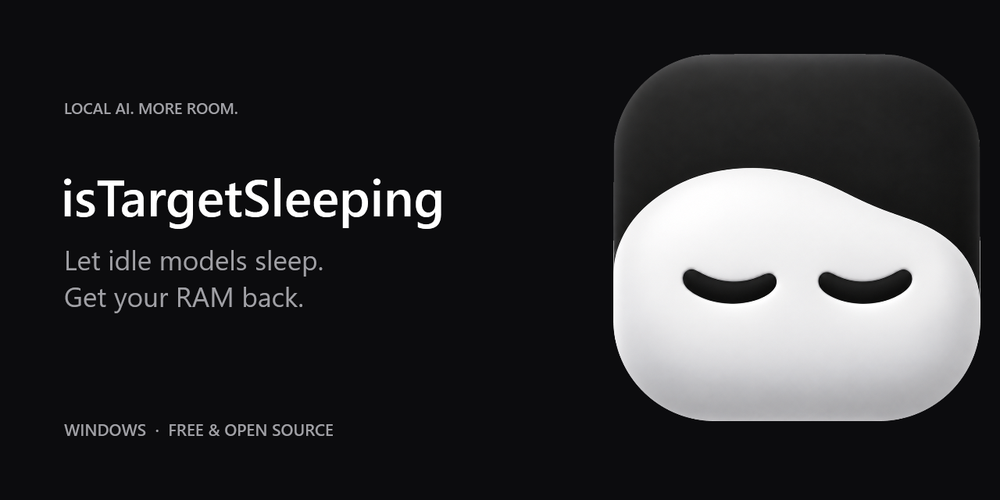
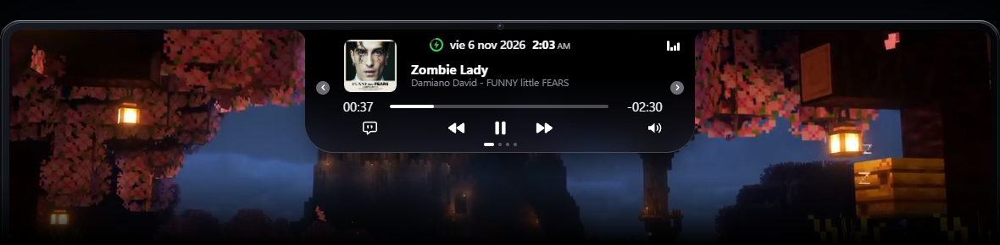
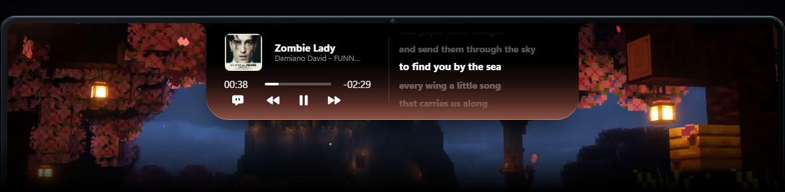
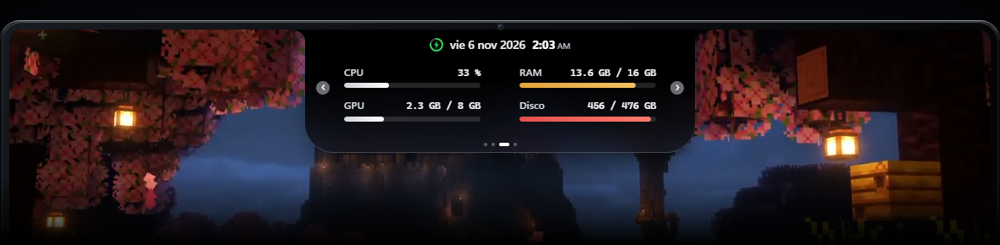
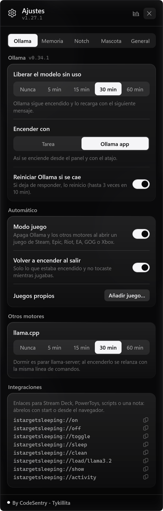

<strong>EL NOTCH DE WINDOWS PARA TU PC</strong>

# isTargetSleeping

<strong>Música, Actividad, agentes y herramientas, siempre a mano.</strong> 
Un espacio pequeño para lo que usas cada día.

<a href="README.md">English</a> · Español

<a href="https://istargetsleeping.web.app/">Explora la nueva web</a> · <a href="https://github.com/Tykillita/isTargetSleeping/releases/tag/v1.29.0">Novedades de la versión</a> · <a href="CHANGELOG.md">Historial de cambios</a>
<a href="https://istargetsleeping.web.app/#video">Ver el recorrido de 77 segundos</a>

  
  
  

Simulador animado del notch · Música · Letra · Sistema

  

App de escritorio actual · Ajustes generales

## El notch de Windows para tu PC

isTargetSleeping pone una superficie compacta de control en el borde superior de Windows. El notch reúne música, actividad del PC, agentes locales y herramientas seleccionadas; Actividad permite revisar la memoria, los procesos y el historial con más detalle.

| **El notch, a tu manera** | **Actividad del PC** | **Agentes en contexto** |
|---|---|---|
| Alterna entre la pastilla compacta, música, letra sincronizada, estado del sistema y tus accesos. | Revisa memoria, procesos, uso de GPU e historial local reciente. | Mantén a mano las sesiones, la actividad y los permisos pendientes de tus agentes. |

## Qué puedes hacer

### Memoria, procesos y Actividad

- Consulta RAM, presión de memoria, uso de modelos y VRAM dedicada. Actividad enumera las GPU que Windows puede identificar.
- Libera memoria por horario, al superar el umbral que elijas o ante presión crítica. Las reglas protegen el modelo y las apps que estés usando.
- Revisa CPU y RAM por proceso, busca y filtra la lista, y confirma antes de cerrar una app o un árbol de procesos.
- Consulta cada semana la RAM recuperada, el tiempo inactivo, el uso y los reinicios, junto con una gráfica de 30 minutos y los eventos recientes. Mira qué app despertó un modelo local.

### El notch: música, sistema y accesos

El notch es la interfaz principal y viene activado. Elige qué muestra la pastilla cerrada, ábrela para ver una vista compacta o el dock, y navega entre Inicio, Widgets, Ajustes y páginas opcionales. Sigue las pantallas que elijas y se oculta en pantalla completa.

Elige algunos widgets opcionales para Inicio y sus páginas. Incluyen música, reloj y calendario, estado del sistema, notas, cámara, teleprompter, archivos y productividad.

Los controles de música, volumen y brillo, el estado del teclado, el uso de cámara y los dispositivos Bluetooth pueden aparecer como actividades junto a la pastilla cerrada. La interfaz funciona con teclado y lectores de pantalla, respeta movimiento reducido y alto contraste de Windows, y está disponible en español e inglés.

### Agentes y mascotas opcionales

La página Agentes y el widget Equipo llevan las sesiones de Claude Code y Codex al notch. Revisa permisos y preguntas, consulta planes, avisos e historial, programa tareas y vuelve a la terminal real. Estas integraciones son opcionales y leen datos locales de las sesiones.

Elige a Mira, una llama, un capibara o un gatito naranja para la barra de tareas. La mascota reacciona a la actividad y a tus acciones; viene apagada.

El chat opcional de la mascota usa un modelo local y conserva la conversación en memoria. La entrada de voz y la lectura en voz alta usan servicios de voz de Windows; el micrófono solo escucha al pulsarlo, nunca está siempre activo.

### Motores de IA local

Ollama y otros motores locales son una parte de la app. isTargetSleeping puede descargar un modelo inactivo de la memoria y dejar su motor disponible, seguir el uso de memoria y ofrecer controles para los modelos y motores.

- Detecta Ollama como app de escritorio, servicio de Windows, tarea programada o <code>ollama serve</code> manual; usa el mismo mecanismo detectado para encenderlo y apagarlo.
- Descarga de memoria el modelo tras 5, 15, 30 o 60 minutos sin generar. Ollama sigue encendido y vuelve a cargar el modelo cuando lo usas.
- Enciende o apaga Ollama, duerme modelos y cárgalos, descárgalos o elimínalos desde la app. Las descargas muestran progreso y se pueden cancelar.
- El vigilante puede reiniciar un proceso de Ollama que se bloquee o deje de responder. El modo juego pausa Ollama mientras un juego está abierto y lo restaura al cerrar el juego.
- Reconoce servidores independientes de <code>llama.cpp</code>. La compatibilidad con <strong>LM Studio es experimental</strong>.
- Las actualizaciones estables son opcionales y vienen apagadas. Si las activas, la app consulta GitHub, verifica SHA-256 y tú eliges cuándo instalar.

## En desarrollo para 1.30.0

| Área | Qué cambia |
|---|---|
| **Páginas de widgets** | Home conserva hasta cuatro celdas. Cada widget adicional aparece en una página propia, accesible desde el control superior. El orden y la configuración existentes se mantienen. |
| **Proveedor de Nimbo** | Elige desde la web móvil privada el proveedor, el modelo y el método de acceso. Las claves API permanecen cifradas en la PC de escritorio. |
| **Calendario más compacto** | Cuando queda solo, el reloj y calendario conserva su vista amplia sin dejar una fila vacía debajo de la agenda. |

## Novedades de la versión 1.29.0

| Área | Qué cambió |
|---|---|
| **Compañero privado** | Un complemento opcional de escritorio sirve la web móvil de forma privada por Tailscale. La web funciona sin una placa ESP32. |
| **Bandeja de agentes** | La página Agentes reúne permisos, preguntas, planes, avisos, resúmenes de ausencia y rutinas pausadas, con pestañas separadas de Historial y Reglas. |
| **Decisiones más seguras** | Elige 30 s, 1 min, 2 min o el máximo de espera para un permiso. Los comandos sensibles no se aprueban con un atajo ni se guardan como regla «Siempre». Elige Todos, Solo lo importante o Nada, y pospón los avisos 30 min, 1 h o hasta mañana. |
| **Sesiones y horarios** | Muestra la rama de Git y, en Claude Code, el contexto de cada sesión. Retoma en una terminal real las sesiones inactivas o terminadas que conservan su carpeta de proyecto. Una tarea programada se pausa tras diez fallos seguidos. |
| **Estado a un vistazo** | Una luz azul, ámbar, roja o verde alrededor del notch indica trabajo de agentes, una decisión pendiente, un aviso o una tarea completada. Las solicitudes esperan cuando una app está a pantalla completa o el modo juego está activo. La actividad Bluetooth muestra el dispositivo y su batería cuando Windows la informa. |
| **Controles más fluidos** | La app añade una pestaña Procesos, navegación más suave por el notch y avisos nativos de Windows con el logo, acceso a Actividad y progreso de descargas. |
| **Equipo más fiable** | El Equipo puede fusionar una rama aunque Git no tenga una identidad configurada. |

## Web móvil y ESP32

La web móvil acompaña a la app de escritorio; no depende de una placa ESP32. También permite elegir qué proveedor y modelo usa Nimbo; las claves API se guardan cifradas en la PC de escritorio.

1. En la app desktop, abre <strong>Ajustes › Notch</strong> y elige <strong>Descargar complemento (opcional)</strong>.
2. Extrae <code>isTargetSleeping-pet.exe</code> en <code>%LOCALAPPDATA%\isTargetSleeping\pet</code>.
3. Vuelve a <strong>Ajustes › Notch</strong>, activa <strong>Mostrar código QR</strong> y escanéalo con un teléfono que use la misma cuenta de Tailscale.

El complemento sirve la web desde esta PC mediante Tailscale, dentro de tu tailnet privado. No utiliza Funnel ni una dirección pública. El mismo complemento opcional de escritorio permite conectar una placa ESP32; la web móvil sigue funcionando sin la placa.

## Descarga e instalación

<strong>Versión estable 1.29.0 · 6 de noviembre de 2026</strong>

| Arquitectura | Instalador | Portable |
|---|---|---|
| <strong>x64</strong> | <a href="https://github.com/Tykillita/isTargetSleeping/releases/download/v1.29.0/isTargetSleeping-1.29.0-setup-x64.exe">Instalador</a> · <a href="https://github.com/Tykillita/isTargetSleeping/releases/download/v1.29.0/isTargetSleeping-1.29.0-setup-x64.exe.sha256">SHA-256</a> | <a href="https://github.com/Tykillita/isTargetSleeping/releases/download/v1.29.0/isTargetSleeping-1.29.0-win-x64.zip">ZIP</a> · <a href="https://github.com/Tykillita/isTargetSleeping/releases/download/v1.29.0/isTargetSleeping-1.29.0-win-x64.zip.sha256">SHA-256</a> |
| <strong>ARM64</strong> | <a href="https://github.com/Tykillita/isTargetSleeping/releases/download/v1.29.0/isTargetSleeping-1.29.0-setup-arm64.exe">Instalador</a> · <a href="https://github.com/Tykillita/isTargetSleeping/releases/download/v1.29.0/isTargetSleeping-1.29.0-setup-arm64.exe.sha256">SHA-256</a> | <a href="https://github.com/Tykillita/isTargetSleeping/releases/download/v1.29.0/isTargetSleeping-1.29.0-win-arm64.zip">ZIP</a> · <a href="https://github.com/Tykillita/isTargetSleeping/releases/download/v1.29.0/isTargetSleeping-1.29.0-win-arm64.zip.sha256">SHA-256</a> |

- <strong>Instalador:</strong> se instala para tu usuario de Windows sin pedir permisos de administrador. No necesitas instalar .NET.
- <strong>Portable:</strong> extrae el ZIP donde quieras y ejecuta <code>isTargetSleeping.exe</code>.
- <strong>Requisitos:</strong> Windows 10 (versión 2004 o posterior) o Windows 11, x64 o ARM64. Ollama es opcional.

La primera vez, la app se abre desde la bandeja y pregunta si quieres iniciar con Windows. El notch viene activado; el panel de la bandeja está en Ajustes.

## Controles rápidos

| Acción | Resultado |
|---|---|
| <strong>Ctrl+Alt+O</strong> | Enciende o apaga Ollama. |
| <strong>Ctrl+Alt+S</strong> | Descarga el modelo activo de memoria sin apagar Ollama. |
| <strong>Ctrl+Alt+L</strong> | Libera memoria con las reglas configuradas. |
| <strong>Pasar el cursor por el notch</strong> | Abre la vista compacta de widgets. Haz clic para ir al Home. |

También puedes usar enlaces como <code>istargetsleeping://on</code>, <code>off</code>, <code>toggle</code>, <code>sleep</code> y <code>load/&lt;model&gt;</code> en accesos directos y scripts.

## Privacidad

- La app de escritorio no requiere cuenta, telemetría ni analítica. Ollama y otros motores usan direcciones locales; los registros de sesiones y los ajustes se leen en tu PC.
- El complemento móvil sirve la web desde esta PC por Tailscale y solo está disponible dentro de tu tailnet. No expone una dirección pública.
- Las búsquedas automáticas de actualizaciones vienen apagadas y solo contactan GitHub si las activas. Las descargas se verifican con SHA-256; no se suben modelos, prompts, ajustes ni historial de uso.
- El tiempo es opcional y solo envía a Open-Meteo la ciudad que eliges. Las letras sincronizadas se consultan en LRCLIB cuando las pides; se envían el título y el artista.
- Windows pide autorización de administrador para instalar el agente de memoria, que se usa al liberar RAM y en acciones de procesos que confirmes.

## Desarrollo

La app de escritorio está escrita en C# con .NET 10, una interfaz WPF nativa e integraciones Win32.

    .\build.ps1
    .\build.ps1 -Test
    .\package.ps1 -RequireInstaller
    .\packaging\verify-release.ps1 -Tag v1.29.0 -VerifyAssets

El flujo de release ejecuta las pruebas de lógica, valida los recursos y empaqueta x64 y ARM64. La matriz completa de combinaciones WPF queda disponible para el trabajo de interfaz: define <code>ITS_ALL_COMBOS=1</code> antes de ejecutar <code>.\build.ps1 -Test</code>.

Para compilar la web localmente:

    pwsh -NoProfile -File site/build.ps1 -Out _site

Consulta <a href="CONTRIBUTING.md">Contribuir</a>, <a href="SECURITY.md">Seguridad</a>, el <a href="CHANGELOG.md">historial completo de cambios</a> y los <a href="THIRD-PARTY-NOTICES.md">avisos de terceros</a>.

## Créditos y licencia

isTargetSleeping se inspira en la idea de <a href="https://github.com/eriktaveras/modelnap">ModelNap</a>, de Erik Taveras. El proyecto tiene implementación nativa para Windows y funciones originales. El aviso MIT de ModelNap se conserva en <a href="LICENSE">LICENSE</a>.

El widget Código usa <a href="https://github.com/material-extensions/vscode-material-icon-theme">Material Icon Theme</a> y AvalonEdit; consulta <a href="THIRD-PARTY-NOTICES.md">THIRD-PARTY-NOTICES.md</a>. Ollama es una marca de sus respectivos propietarios; este proyecto no está afiliado a Ollama.

---

<em>Deja descansar al modelo. Mantén despierto el resto de tu escritorio.</em>

