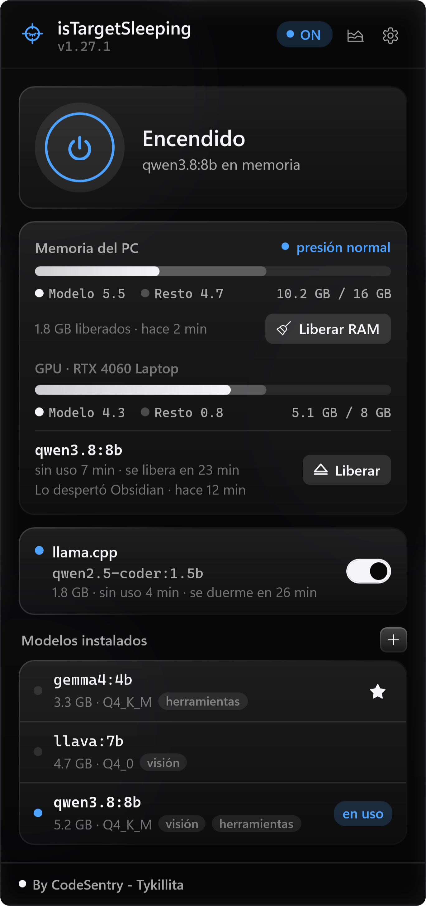
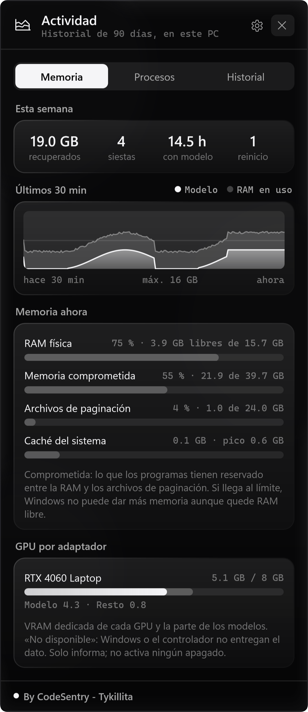
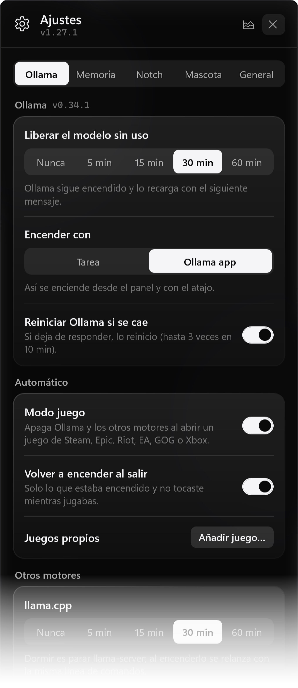
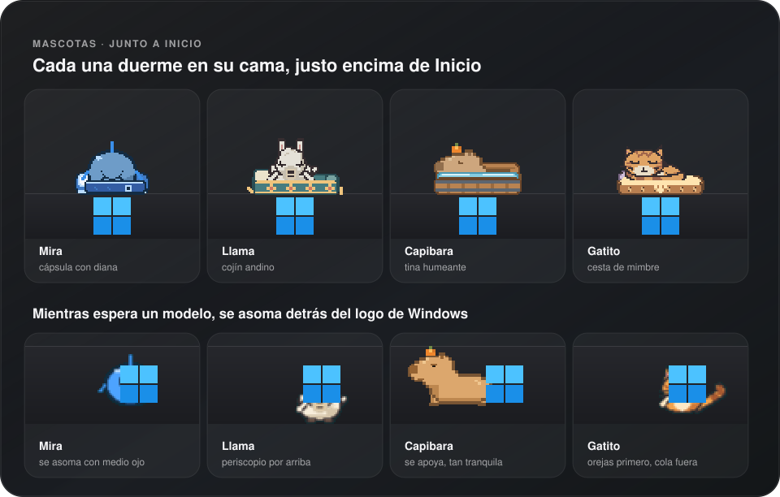
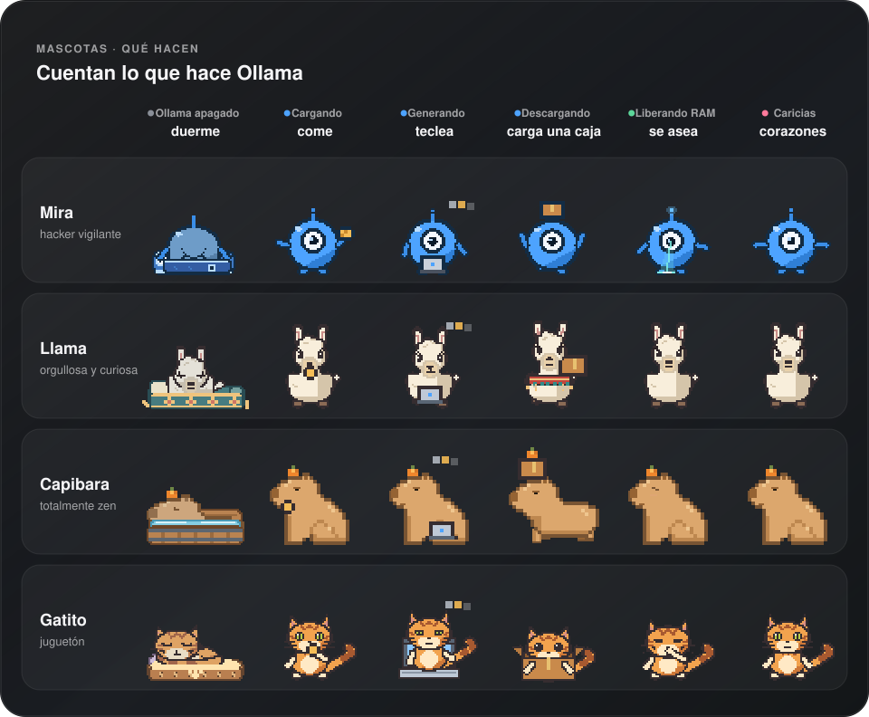
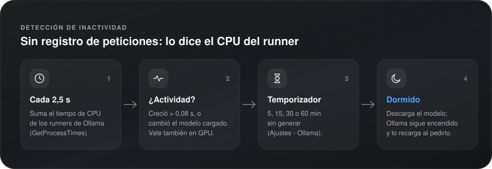
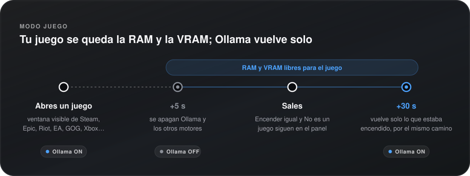

<div align="center">


El icono de la mascota dormida forma parte de la versión 1.29.0.

# isTargetSleeping

**Un notch para Windows: Ollama, tu PC y tus herramientas, a un vistazo.**

[English](README.md) · **Español**

<!-- La placa de versión repite VERSION: actualiza las dos a la vez. -->
[](CHANGELOG.md)


[](LICENSE)

<br>

&nbsp;&nbsp;&nbsp;&nbsp;<a href="docs/images/settings-es.png"></a>

<p>
  <a href="#video">Video</a> &bull;
  <a href="#-funciones">Funciones</a> &bull;
  <a href="#-mascotas">Mascotas</a> &bull;
  <a href="#-instalar">Instalar</a> &bull;
  <a href="#-uso">Uso</a> &bull;
  <a href="#como-funciona">Cómo funciona</a> &bull;
  <a href="#-privacidad">Privacidad</a> &bull;
  <a href="#desarrollo">Desarrollo</a> &bull;
  <a href="CONTRIBUTING.md#es">Contribuir</a> &bull;
  <a href="SECURITY.md#es">Política de seguridad</a>
</p>

<sub>By <b>CodeSentry - Tykillita</b></sub>

</div>

<br>

App nativa de Windows que vive en la bandeja o, si prefieres, en el borde superior de la pantalla como un notch. Su
primer módulo es [Ollama](https://ollama.com): vigila tus modelos locales, los pone a dormir cuando dejan de trabajar
y te devuelve la RAM, y enciende o apaga Ollama con un clic, lo hayas instalado como lo hayas instalado. El notch suma
widgets: sistema, reloj y calendario, Pomodoro, notas y más.

<a id="video"></a>

Vista previa de 1.27.1: [ver o descargar el MP4 de 77 segundos](docs/video/isTargetSleeping-tour-es.mp4).

<p align="center"><sub>La vista previa de 1.27.1 en 77 segundos, con datos de ejemplo. Activa el sonido para escuchar música y efectos · <a href="https://istargetsleeping.web.app/media/isTargetSleeping-tour-es.mp4">abrir el video</a> · <a href="https://istargetsleeping.web.app/?lang=es#video">ver en la web</a> · <a href="README.md#video">in English</a> · <a href="https://github.com/Tykillita/isTargetSleeping/raw/refs/heads/main/docs/video/isTargetSleeping-tour-es.mp4">descargar el MP4</a></sub></p>

<p align="center"><sub>Edición aparte para Reels: 1080 × 1920 (9:16), el mismo guion y música de 77 segundos, textos ampliados, las mascotas de la 1.27.1 y clics de mouse visibles con sonido · <a href="https://istargetsleeping.web.app/media/isTargetSleeping-reel-es.mp4">MP4 en español</a> · <a href="https://istargetsleeping.web.app/media/isTargetSleeping-reel-en.mp4">English MP4</a></sub></p>

## ✨ Funciones

| | Función | Detalle |
|:-:|---|---|
| ⏻ | **Encender y apagar** | El botón grande del panel, o **Ctrl+Alt+O** desde cualquier app. |
| 🔍 | **Detecta tu instalación** | La app de Ollama, un servicio de Windows (NSSM, WinSW, `sc create`…), una tarea programada o un `ollama serve` a mano. Lo apaga por el mismo camino por el que arranca. |
| 🧹 | **Libera la memoria sin uso** | Tras 5, 15, 30 o 60 minutos sin generar, saca el modelo de la memoria. Ollama sigue encendido y lo recarga con el siguiente mensaje. **Ctrl+Alt+S** lo duerme al momento. |
| 🧽 | **Liberar RAM** | Limpieza automática al pasar de tu porcentaje (repite tras una pausa mínima mientras siga alta), cada cierto tiempo o con presión crítica; también con el botón o **Ctrl+Alt+L**. Protege modelos, juegos y la app que estás usando. No necesita Mem Reduct. |
| 🔎 | **Reconocimiento de procesos** | Pestaña **Procesos** en la ventana de la app y **Actividad › Procesos** dentro del notch (o del panel de la bandeja): RAM y CPU por aplicación, PIDs desplegables, búsqueda, filtros, orden, pausa y actualizar, y cierre forzado confirmado de una aplicación, un proceso o un árbol. |
| 🎮 | **Modo juego** | Abres un juego de Steam, Epic, Riot, EA, GOG, Rockstar o Xbox (o uno que añadas) y Ollama se apaga para dejarle la RAM y la VRAM; al salir vuelve a encenderse por el mismo camino. |
| 🛟 | **Vigilante** | Si Ollama se cae o se cuelga, lo reinicia con el mismo mecanismo (hasta 3 veces en 10 minutos). |
| 🔔 | **Notificaciones** | Avisos nativos de Windows con el logo de la app cuando un modelo se duerme, Ollama se cae, la memoria llega a crítica, empieza un juego o termina una descarga. El aviso de modelo dormido abre Actividad; las descargas muestran el progreso de las capas detectadas. Cada tipo tiene su interruptor. |
| 📊 | **Memoria del PC y de la GPU** | RAM en uso (la misma cifra que el Administrador de tareas), **VRAM** dedicada de tu GPU, cuánto de cada una es del modelo y la presión de memoria. Con varias GPU, Actividad lista cada una (total, en uso, modelos); un dato que Windows no entrega se muestra como no disponible. |
| 👀 | **Quién lo despierta** | Qué app cargó el modelo (Obsidian, Cursor, un script…), por su conexión al puerto de Ollama. |
| 📈 | **Actividad** | Esta semana: GB recuperados, siestas, horas con modelo cargado, reinicios; gráfica de 30 min, **memoria ahora** (RAM física, memoria comprometida, archivos de paginación y caché del sistema, como Mem Reduct) y los últimos eventos. |
| 🗂️ | **Modelos** | Tamaño, cuantización y etiquetas *visión* / *herramientas*. Cárgalos, **descárgalos** (con progreso y cancelable) o **bórralos** desde el panel. |
| 🧩 | **Otros motores** | Un `llama-server` de **llama.cpp** propio tiene su tarjeta y su siesta; **LM Studio**, de forma experimental. |
| 🔗 | **Enlaces** | `istargetsleeping://on`, `off`, `toggle`, `sleep`, `load/<modelo>`… para Stream Deck, PowerToys o scripts. |
| 🎯 | **Estado de un vistazo** | La mascota dormida en la bandeja muestra un punto azul, ámbar o ninguno; abre los ojos con un modelo cargado y se mueve mientras Ollama se enciende o se apaga. |
| 🐾 | **Mascotas con personalidad** | Elige a **Mira**, una **llama**, una **capibara** o un **gatito naranja**. Una vive en la barra de tareas (sobre Inicio, a su izquierda o de paseo) y cuenta lo que hace Ollama: duerme en su cama, come mientras carga un modelo, teclea mientras genera y se asea a su manera mientras libera RAM. Cada una reacciona a tus clics y a tu cursor a su manera — dormida, sin salir de la cama. Apagadas por defecto; [más abajo](#-mascotas). |
| 📱 | **Mascota móvil privada** | En Ajustes › Notch puedes descargar el servidor complementario opcional y usar su QR para abrir la web móvil por Tailscale. La web funciona sin ESP32; la placa es un cliente opcional. |
| 🪟 | **Notch** | La interfaz principal, activada por defecto (el panel de la bandeja es la «Versión legacy» opcional, apagada por defecto, en Ajustes > Notch): una pastilla pegada al borde superior de la pantalla, en el monitor donde está el cursor, con los tres datos que elijas (estado, modelo y RAM por defecto; también puedes elegir la música que suena, con su indicador y su título desplazándose). Pasa el ratón para una vista corta que personalizas con tus widgets (por defecto Ollama: estado, RAM y GPU, Liberar RAM, Liberar modelo, Procesos); haz clic para el Home. Dos tiras de iconos debajo dan navegación de un clic (Inicio, Widgets y Ajustes, y Ollama y Actividad si los activas) y hasta cuatro favoritos que eliges tú, con un botón de fijar que mantiene el notch abierto. También puedes añadir una página Cámara en Ajustes > Notch: abre una vista previa local al entrar y la detiene al salir. El panel es negro puro arriba y se funde en cristal líquido (lo de detrás, desenfocado), las cápsulas del dock también son de cristal y, si pulsas y arrastras por sus botones, una lente de cristal te sigue y abre la página donde cae. Los avisos del sistema (volumen, brillo, Bloq Mayús, Bloq Núm e idioma del teclado) salen en el notch cerrado como una cápsula negra más ancha, y las letras sincronizadas de la música (lrclib.net) se ven en la vista al pasar el ratón y, si quieres, como la línea que se canta en el notch cerrado. Se oculta mientras algo está a pantalla completa. Si la herramienta de recortes se cuelga y congela la pantalla (su ventana no responde, o su capa a pantalla completa sigue ahí pasados 30 segundos), la app la cierra sola. |
| 🧩 | **Widgets** | El Home del notch tiene cuatro celdas que eliges y ordenas en la página Widgets (todas las listas de esa página son carpetas de cristal como las del iPhone; toca una opción para ver cómo se ve de verdad en uso y elegir su tamaño y posición): Ollama, Sistema (CPU, RAM, VRAM, disco, red), Reloj y calendario (un mes con flechas, una agenda de recordatorios que añades con una regla de días que arrastras, y los eventos de un archivo .ics opcional), Pomodoro (con aviso), Mantener despierto (con el estado que aceptó Windows), Notas (se guardan solas, en local), Batería y Música (lo que Windows dice que suena, con controles macizos, aleatorio y repetir, y el color de la portada). Si no suena nada, Música ofrece accesos a reproductores conocidos instalados; si no encuentra ninguno, enseña la preview de la galería con una pista original de jazz de Nueva Orleans, pausada hasta que pulses reproducir y de una sola pasada salvo que actives el bucle. Ollama, Código y LM Studio también tienen versión 1×1; Código muestra un resumen del README y el stack detectado en local. Los widgets van directamente sobre el cristal, sin tarjetas, en dos columnas que se rellenan por la más corta. Todo se lee en local. |
| ✨ | **Galería de widgets** | La página Widgets destaca la tarjeta elegida en un carrusel 3D de vidrio; las vistas laterales quedan separadas, sin colocarse detrás de la central, mientras el widget actual se aleja y el siguiente llega al centro, sin un zoom repentino. Las columnas de nubes 3D solo aparecen en 1×1, quedan fijas al visor y se hinchan suavemente alrededor del mismo centro, sin desplazarse; se desvanecen al elegir tamaños mayores y reaparecen al volver a 1×1. Se ocultan en alto contraste. Notas usa su acento amarillo en la pastilla para añadir o quitar. |
| 🎚️ | **Audio por app y HUDs** | El widget Audio controla y recuerda el nivel del mezclador de Windows de cada app con una sesión activa. Los HUDs opcionales del notch muestran volumen, Bloq Mayús/Bloq Núm, brillo en pantallas internas compatibles y conexiones de audio. |
| 🧩 | **Editor de widgets y gráficas del sistema** | Añade, arrastra, ordena y ensancha widgets compatibles del Home (hasta cuatro celdas); guarda o descarta los cambios. Elige dos gráficas del sistema entre seis métricas o consulta las seis en la vista ancha. |
| 📊 | **Uso de IA en varios proveedores** | Opcional y apagado por defecto. Muestra las ventanas de cuota de Claude, Codex, Gemini y Muse; los modelos locales activos de Ollama; y el gasto del equipo en Grok API si configuras `XAI_MANAGEMENT_API_KEY` y `XAI_TEAM_ID`. Solo dibuja barras cuando el proveedor informa un porcentaje; el gasto de Grok API no es la cuota de una suscripción Grok. |
| 🔐 | **Aprobar permisos de Claude Code desde el notch** | Opcional, apagado por defecto (Ajustes › General). Añade hooks a `~/.claude/settings.json` (con copia de seguridad, sin tocar los tuyos; al apagarlo se quitan) y, cuando Claude Code pide permiso, el notch se abre con una tarjeta con el proyecto y el comando exacto: **Permitir**, **Siempre** (regla propia: mismo proyecto y herramienta y, en Bash, el mismo comando) o **Denegar**; Y, N y Esc desde el teclado (Esc lo deja a la terminal). Varias peticiones hacen cola. Habla con la app por un canal local solo de tu usuario, sin red; si la app no corre o nadie responde en 280 s, Claude Code pregunta en su terminal como siempre. Un aviso sonoro suave (apagable) y la mascota de la barra reaccionan cuando un agente pide permiso o termina. |
| 💬 | **Chat con la mascota** | Opcional, apagado por defecto (Ajustes › General): una página «Chat» en el dock del notch donde responde, con mensajes cortos y amables, el modelo local que ya tengas cargado en Ollama. Nunca carga un modelo por su cuenta (si no hay ninguno, te lo dice), nada sale de tu PC y la charla solo vive en memoria; la respuesta llega en streaming y puedes pararla. Cada mascota habla con su carácter (Mira seca y vigilante, la llama orgullosa y dramática, la capibara serena, el gatito juguetón). Un **vínculo** de cinco niveles sube con el uso sano (charlar, que un agente termine, acabar un Pomodoro; con tope diario por tipo), nunca baja si te ausentas, se guarda en local y puedes reiniciarlo; no premia la RAM liberada. Su **humor** (preocupación con la memoria crítica, alerta si un agente espera tu permiso, alegría tras algo bueno, sueño de noche, calma) se ve en la página y marca cómo te habla. |
| 🧾 | **Filas de sesión más ricas** | Bajo el nombre de cada sesión en la página Agentes: su **rama de git** (leída de `.git/HEAD`, también en worktrees y sin ejecutar git) y cuánto **contexto** usa, en miles de tokens, según la última respuesta de su log (solo sesiones de Claude Code; es el contexto en uso, no un porcentaje, porque el tamaño de la ventana no viene en el log). |
| 🛑 | **Disyuntor de las tareas programadas** | Una tarea programada del widget Equipo que falla **diez veces seguidas** se apaga sola (conserva su historial) en vez de gastar tokens sin parar: la lista dice «pausada tras 10 fallos seguidos» y aparece un aviso en la página Agentes. Un éxito pone la cuenta a cero, cancelar o perder una ejecución no cuenta y volver a encenderla a mano empieza de cero. Las tareas «cada N horas» ya guardan un mínimo de una hora entre ejecuciones. |
| ⏱️ | **Plazo para decidir** | En Ajustes › General eliges cuánto espera el notch tu respuesta a un permiso (30 s, 1 min, 2 min o el máximo) antes de dejarlo a la terminal de Claude Code. Claude Code corta el hook a los 5 minutos, así que ese es el máximo. |
| 🔕 | **Control de avisos de agentes** | En Ajustes › General: **Todo** (por defecto), **Solo lo importante** (permisos, preguntas, planes, avisos graves y el resumen al volver) o **Nada**, y **posponer** 30 min, 1 h o hasta mañana. Decide si algo suena, suena la campana o se abre el notch solo; las peticiones y los avisos siempre quedan en la página Agentes (con «Nada», un permiso espera ahí sin abrir el notch ni sonar). |
| ▶️ | **Retomar una sesión en la terminal** | En la página Agentes, cada sesión de Claude Code o Codex que no usa nadie (terminada o inactiva, con un id que se pueda retomar y su carpeta existente) tiene un botón «Retomar en la terminal»: abre Windows Terminal (o PowerShell) en la carpeta del proyecto y ejecuta `claude --resume <id>` / `codex resume <id>` para que sigas tú. A diferencia de la caja de preguntas de solo lectura del widget Agentes, aquí te da el CLI de verdad. Nunca se ofrece en sesiones que trabajan (dos escritores se pisarían el archivo de sesión). |
| 🕘 | **Mientras no estabas** | Al volver tras 10 minutos o más sin tocar teclado ni ratón, la mascota te resume qué hicieron tus agentes entretanto: cuántos terminaron, cuántos permisos se pidieron, cuántos avisos saltaron y cuántas peticiones siguen esperándote. Sale como tarjeta en la página Agentes, como mensaje de la mascota en el Chat y con la campana del notch; calla en modo juego y si no pasó nada. |
| 💡 | **Luz del notch según tus agentes** | Un haz de luz da la vuelta al borde del notch (Ajustes › General; encendida por defecto): entra por la oreja derecha y sale por la izquierda sin pasar por arriba. **Azul** mientras un agente trabaja, **ámbar** cuando algo espera tu respuesta, **rojo** si hay un aviso (atascado, en bucle o un límite de uso agotado) y **verde** unos segundos al terminar. Un estado nuevo espera a que acabe la vuelta actual. Con movimiento reducido se queda como un aro fijo y en alto contraste usa el color del texto. |
| 🗂️ | **Estante** | Una bandeja temporal para archivos y carpetas: suéltalos en el widget, abre uno con un clic, arrástralos hacia fuera cuando los necesites o quítalos (varios a la vez). Solo guarda sus rutas, nunca mueve ni copia nada y olvida los archivos que desaparecen. Al soltar, una ola recorre el widget. |
| ✅ | **Tareas** | Una lista con contador de «hechas hoy», tareas con título y hora, repetición diaria y un calendario del mes para ver un día o preparar los futuros. Pulsa la tarjeta para ensancharla. Se guarda en tu PC. |
| 🚨 | **Avisos de agentes** | En la pestaña «Ahora» de la página Agentes, y con una campana en el notch la primera vez que sale cada uno: un agente que lleva 2 minutos sin dar señales (atascado o esperando un comando largo), uno que repite seis veces seguidas la misma herramienta sobre el mismo archivo (posible bucle) y un límite de uso (Claude, Codex, Gemini) al 90 % o agotado, con cuenta atrás de cuándo vuelve. Se calculan en local con los logs de las sesiones y el widget de uso de IA. Con algo a pantalla completa, un permiso nuevo no abre el notch ni te quita el foco: espera en la cola y se abre solo al salir. |
| ❓ | **Preguntas y planes de Claude Code desde el notch** | Cuando Claude Code te hace una pregunta, el notch enseña sus opciones como botones (una por pregunta, o varias si el agente lo permite) y «Enviar respuesta» se las devuelve; cuando propone un plan, enseña su texto con «Aprobar el plan» y «Pedir cambios» (le dice al agente que quieres cambios). «Decidir en la terminal» y Esc lo dejan a la terminal. Claude Code solo acepta estas respuestas desde un hook `PreToolUse`, así que al activar la aprobación de permisos también se instala uno filtrado a `AskUserQuestion\|ExitPlanMode` (no toca ninguna otra herramienta). Nunca se guardan como reglas «Siempre». |
| 🧭 | **Centro de agentes** | Una página «Agentes» en el dock del notch (aparece al aprobar permisos desde el notch) con tres pestañas: **Ahora** (cada petición que espera tu respuesta, con Permitir / Siempre / Denegar ahí mismo, y tus últimas sesiones), **Historial** (un registro local de lo que pidió cada agente y qué respondiste: permitido, denegado, siempre, automático o terminal; se recorta solo y puedes borrarlo) y **Reglas** (todas tus reglas «Siempre», para revocar cualquiera). Una **guardia de comandos delicados** (borrados recursivos, `git push --force`, `git reset --hard`, scripts descargados que se ejecutan al vuelo, `sudo`, formatear discos, borrar bases de datos, apagar el equipo, tocar credenciales…) marca la tarjeta en rojo: no se pueden permitir con la tecla Y ni guardar como «Siempre», y ninguna regla los deja pasar sola. |
| 🎙️ | **Voz de la mascota** | Opcional y 100 % local: un botón de micrófono en la página Chat escucha **una frase** cada vez que lo pulsas (nunca hay escucha permanente) con el reconocedor de voz de Windows, y un interruptor hace que la mascota **lea sus respuestas en voz alta** con una voz de Windows. Ningún audio sale del PC. Necesita un reconocedor de voz de Windows para tu idioma; sin él, el micrófono no aparece. |
| 📅 | **Resumen semanal y charla ambiente** | La página Chat enseña tu semana (mensajes, agentes que terminaron, permisos concedidos y denegados, Pomodoros y siestas del modelo), contada en local y a cero cada lunes. La **charla ambiente** (Ajustes › General; apagada por defecto, «Rara vez» o «A veces») hace que la mascota añada de vez en cuando una frase corta y amable según su humor y su vínculo, con una campana en el notch; no usa el modelo, respeta un mínimo entre frases y calla en modo juego, con un permiso pendiente o mientras escucha. |
| 🤖 | **Actividad de agentes de código** | El selector fijo separa sesiones activas y recientes de Claude Code y Codex. En Recientes puedes consultar sesiones terminadas o inactivas hasta 12 horas, buscar por nombre, proyecto, agente o actividad y filtrar por agente, proyecto y estado con menús desplegables adaptados al tema de cristal. El resumen cuenta llamadas de herramientas completadas y archivos distintos solo cuando la ruta aparece explícitamente en el log; las sesiones que necesitan atención conservan ese estado y muestran cuánto llevan inactivas. Con la actividad en vivo activada, las tareas programadas locales de Codex o Claude Code que identifican su tarea en el registro muestran su nombre al terminar; las tareas en la nube no se detectan. No muestra prompts, argumentos ni salidas completas de comandos; los logs se leen en local y nunca se envían. |
| 🧑‍💻 | **Equipo Claude + Codex** | Un widget del notch que reparte una tarea entre Claude Code y Codex. Un enrutador elige quién planifica, implementa y revisa (reparto: Auto, Ahorro, Calidad, Diseño, Velocidad, Solo Claude, Solo Codex) y qué modelo usa cada paso; los modelos de Codex se leen de tu propio `~/.codex/models_cache.json`. Cada tarea corre en su propio worktree y rama de git (`team/…`) y nunca se fusiona sola: el otro modelo revisa el diff (hasta tres rondas), pones un tope de tokens, puedes aprobar o editar el plan antes, pedir cambios sobre la misma rama, leer el diff en el notch y fusionar o descartar. Las preguntas sencillas no necesitan proyecto: se detectan y las responde un agente rápido con búsqueda web, con aviso de Windows cuando la respuesta está lista. Una pestaña Tablero agrupa cada tarea según lo que necesita de ti. Escribe la tarea en una barra de cristal: adjunta hasta treinta imágenes (botón, arrastrar o pegar), elige el reparto y fija el esfuerzo de los agentes de Auto a Máximo con un tacómetro. Las respuestas se pueden seguir después con otra pregunta, y las sesiones terminadas de Claude Code y Codex se retoman (en solo lectura) desde el widget Agentes de IA. Necesita las CLI de Claude Code y Codex, con la sesión iniciada por ti. |
| 🗓️ | **Tareas de agentes programadas** | La página Programadas del equipo repite una tarea una vez, cada día, de lunes a viernes, cada semana o cada N horas, con tope de tokens y recuperación opcional de hasta 12 horas si la app estaba cerrada. Corren con la app abierta o, sin ella, con `isTargetSleeping --team-due` desde el Programador de tareas de Windows. Cada ejecución queda en el Historial con su rama. Elige el aspecto en Ajustes: Tubería, Línea de tiempo o Mesa de equipo; el notch cerrado también puede enseñar el avance del equipo como dato de la pastilla, actividad en vivo o favorito «cancelar tarea». |
| 📅 | **Calendario, tiempo, OCR y teleprompter** | Los eventos del calendario muestran progreso y enlaces de reunión; el tiempo opcional consulta la ciudad elegida en Open-Meteo; el OCR local copia texto de una imagen de la Bandeja o de una región de pantalla; el teleprompter guarda el texto localmente y en 1×1 permite editar, reproducir o pausar, reiniciar y ver el progreso de lectura. |
| 🫧 | **Más controles del notch** | Ajusta el fundido del cristal, oculta el notch en apps elegidas y usa el estilo de movimiento compartido; el OSD de volumen de Windows sigue disponible. |

| ⚡ | **Actividades en vivo** | En cápsulas a los dos lados de la pastilla cerrada del notch, lo que pasa ahora: a la izquierda, lo de Ollama (liberando RAM, encendiéndose o apagándose, memoria crítica) y un punto de estado cuando Windows indica que la cámara está en uso; si activas Cámara, el punto también aparece apagado y queda a la derecha de Liberar RAM. A la derecha, el volumen cuando cambia, un Pomodoro en marcha, Mantener despierto y, si lo activas, la música que suena. Hasta una actividad de Ollama, una cámara y dos a la derecha, cada una con su interruptor; el uso de cámara se detecta localmente y tocar el punto abre su vista previa. Debajo de la preview se listan las apps que transmiten. En Comet, «Administrar» abre los permisos de sitios para bloquear Discord Web; para otras apps de escritorio, Windows solo ofrece un interruptor global de cámara. El widget de Música salta de pista al deslizarlo con el ratón o con dos dedos en el trackpad, y su barra de progreso se puede pulsar. |
| 📥 | **Bandeja de archivos, portapapeles y favoritos de apps** | Arrastra archivos o carpetas al notch y esperan en su página Bandeja (solo sus rutas, en memoria) hasta que los arrastras de vuelta, copias su ruta, los enseñas en el Explorador o los comprimes todos en el Escritorio. Las filas enseñan miniaturas de las imágenes e iconos de Material para las carpetas, con cuántos elementos y cuánto pesa cada carpeta; el doble clic abre un elemento, una carpeta se puede abrir como proyecto en el widget Código, puedes pegar archivos que copiaste en el Explorador, arrastrar todo de una vez y, si quieres, recordar la bandeja entre sesiones (Ajustes > General, solo las rutas). El historial del portapapeles, opcional (Ajustes > General, apagado por defecto), guarda los últimos 25 textos que copias, solo en memoria, y se salta lo que los gestores de contraseñas marcan como privado. Los archivos de texto de la bandeja se pueden editar y guardar ahí mismo (Ctrl+S) para cambios rápidos mientras programas, y el widget **Código** es un IDE pequeño: eliges una carpeta y obtienes su árbol de archivos (con los iconos de Material Icon Theme), pestañas, un visor de imágenes y un editor de texto con colores de sintaxis para Markdown, código, JSON, YAML, XML y más. Su vista 1×1 muestra el stack del proyecto y un fragmento del README; el análisis solo lee archivos locales. Los favoritos también pueden abrir cualquier app o archivo que elijas. |
| ♿ | **Teclado y lectores de pantalla** | Cada botón e interruptor se alcanza con Tab, muestra un anillo de foco y tiene nombre accesible; sigue el tema de alto contraste de Windows. |
| 🌍 | **Español e inglés** | Sigue el idioma de Windows, o elígelo en Ajustes. |
| 🖤 | **Vidrio negro** | En el panel de la bandeja, vidrio negro ahumado sobre el acrílico real de Windows 11; en el notch, negro puro que se funde en cristal líquido (desenfoca lo de detrás y lo tiñe para que el texto se lea). Tarjetas translúcidas e interfaz monocroma con color solo para el estado (y el color de la portada para la música). El ícono de la bandeja sigue el modo de la barra de tareas. |
| 🔄 | **Actualizaciones** | Opcionales y apagadas por defecto. Si las activas, busca versiones estables en GitHub; tú decides cuándo instalar. Verifica SHA-256, admite los tres archivos del ZIP oficial y vuelve atrás si algo falla. |
| 🔒 | **Privado** | La app de escritorio no requiere cuenta, telemetría ni analítica. Su web móvil opcional usa tu cuenta de Tailscale y se conecta solo a esta PC; las actualizaciones consultan GitHub si las activas. |

## 📥 Instalar

**1.5.0 ya está publicada** (2 de octubre de 2026): memoria ahora en Actividad, reglas de limpieza
automática completas y mascotas renovadas.

**1.5.2 ya está publicada** (3 de octubre de 2026): encendido y apagado de servicio y tarea verificados con
Ollama real en Windows.
[Validación y límites](docs/backend-validation-1.5.2.md#es).

**1.6.0 ya está publicada** (14 de octubre de 2026): apagar Ollama cierra solo los servidores que se demuestran
del backend elegido, Actividad muestra la VRAM de cada GPU y el panel se puede usar con teclado, con nombres
accesibles y tema de alto contraste. Incluye además el arreglo del actualizador: limita las entradas del ZIP a los
archivos esperados y mantiene la extracción dentro de su carpeta temporal. Consulta el [changelog](CHANGELOG.md).

**1.6.1 ya está publicada** (14 de octubre de 2026): apagar Ollama también cierra el servidor que arrancó esta app,
aunque después abras la app de Ollama, y liberar RAM ya no hace que el vigilante reinicie Ollama ni que la mascota
entre y salga de su cama.

**La versión 1.29.0** incluye la web móvil privada de la mascota y un complemento independiente que puede conectar una placa ESP32; la web funciona sin la placa. También añade una bandeja única para permisos y preguntas de agentes, control de avisos, aprobaciones más seguras, reanudación de sesiones, resumen semanal, transiciones más fluidas del notch y fusiones del Equipo aunque Git no tenga una identidad configurada. El notch es la interfaz principal; el panel de la bandeja sigue disponible como vista legacy opcional.

**La 1.27.1 ya está publicada** (27 de octubre de 2026): incluye las mejoras de 1.27.0 para Equipo Claude + Codex y las tareas programadas, Notas, Clima/LED, accesibilidad y limpieza de RAM. La galería de Widgets mantiene las mismas tarjetas WPF durante el giro 3D: el widget lateral entra al centro sin sustituirse por una copia ni dar un salto de zoom. También reconoce el uso de cámara de Windows, muestra un punto de estado en el notch —con halo azul tenue cuando está activa— y ofrece una vista previa local opcional. La lista de apps abre los permisos por sitio de Comet, donde puedes bloquear Discord Web; para otras apps de escritorio, Windows solo ofrece un interruptor global de cámara. Las actividades de cámara, brillo y volumen ahora se actualizan con rapidez, sin reconstruir todo el panel. Con la actividad en vivo activada, las tareas programadas locales de Codex o Claude Code identificadas en sus registros anuncian su nombre al terminar; las tareas en la nube quedan fuera. Cuando no suena nada, Música abre un reproductor conocido instalado o muestra una preview pausada con jazz original si no hay ninguno. Las carpetas usan cristal ahumado grafito neutro, mantienen el espacio 3×3 y llenan los iconos por filas. Consulta el [changelog](CHANGELOG.md).

**1.20.0 ya está publicada** (17 de octubre de 2026): el notch pasa a ser de cristal líquido (negro puro que se funde en vidrio esmerilado, cápsulas de cristal en el dock y una lente de cristal que arrastras por él), widgets sin tarjetas en dos columnas, un widget de Música teñido con la portada y un calendario con una agenda de recordatorios locales y un archivo .ics opcional, actividades en vivo a los dos lados del notch, un botón de fijar, Ajustes y Actividad en pestañas y el reconocimiento de procesos dentro del notch.

**1.11.0 ya está publicada** (16 de octubre de 2026): la música que suena en la pastilla cerrada del notch (con su título
desplazándose) y una bandeja de archivos mucho mejor (miniaturas, tamaño de carpetas, abrir como proyecto, pegar, arrastrar
todo y memoria opcional entre sesiones).

**1.10.0 ya está publicada** (15 de octubre de 2026): una bandeja de archivos donde soltar lo que arrastras (con edición
rápida de texto), un widget Código con árbol de archivos, pestañas, visor de imágenes y editor con colores de sintaxis,
un historial del portapapeles opcional y favoritos de apps.

**1.9.0 ya está publicada** (15 de octubre de 2026): actividades en vivo junto a la pastilla cerrada del notch, un widget de
Música con portada, controles de reproducción y barra de progreso pulsable, y el volumen en el notch.

**1.8.0 ya está publicada** (15 de octubre de 2026): un dock tipo notch opcional en el borde superior de la pantalla
que se abre al pasar el ratón, con un Home de widgets que eliges y ordenas (Ollama, sistema, reloj y calendario,
Pomodoro, mantener despierto, notas, batería) y favoritos configurables. Incluye el notch de la 1.7.0, que no llegó a
publicarse por separado.

**Descargas:** la última versión publicada es la 1.29.0. Los instaladores y paquetes portables x64 y ARM64 están en su release de GitHub.

**Portable:** descarga `isTargetSleeping-<versión>-win-x64.zip` (o `-arm64`), descomprímelo donde quieras y abre
`isTargetSleeping.exe`. Es un único `.exe` autocontenido: no hace falta instalar .NET. Para las notificaciones modernas de Windows, la app crea un acceso directo en el menú Inicio de tu usuario cuando hace falta y guarda una copia local del logo.

**Instalador:** `isTargetSleeping-<versión>-setup-x64.exe` lo instala para tu usuario en
`%LOCALAPPDATA%\Programs\isTargetSleeping` (sin administrador).

La primera vez abre su panel junto al reloj y pregunta si abrir al iniciar sesión. Si no ves el ícono, puede estar
entre los ocultos (`^`): en Windows 11 la app lo saca sola a la barra (puedes apagarlo con **Mostrar el ícono en la barra** en el clic derecho del ícono, o con **Mostrar siempre en la barra de tareas** en Ajustes › General); si no lo ves, activa ese interruptor, arrástralo a
la barra, o actívalo en *Configuración › Personalización › Barra de tareas › Otros iconos de la bandeja del sistema*.
Si el interruptor no aparece (Windows 10, o Windows 11 antes de registrar el ícono), Ajustes › General trae un botón
que abre los ajustes de la barra de tareas.

**Requisitos:** Windows 10 (2004+) u 11 · x64 o ARM64 · [Ollama](https://ollama.com/download/windows).

## 🧭 Uso

| Acción | Resultado |
|---|---|
| **Clic** en el ícono | Abre el panel (clic fuera o Esc para cerrarlo) |
| **Arrastrar** la cabecera del panel | Lo mueve; desde entonces se abre ahí. **Doble clic** en la cabecera: vuelve junto a la bandeja |
| **Clic derecho** | Encender/apagar, dormir el modelo, actividad, ver el log de Ollama, abrir al iniciar sesión, *Acerca de*, salir |
| **Ctrl+Alt+O** | Enciende o apaga Ollama desde cualquier app |
| **Ctrl+Alt+S** | Duerme el modelo (y los de los otros motores) sin apagar nada |
| **Ctrl+Alt+L** | Libera RAM (con el agente de memoria activado) |
| **Clic en un aviso** | Abre el panel |

El panel tiene tres vistas: la principal, **Actividad** (ícono de gráfica) y **Ajustes** (engranaje); si no caben en
la pantalla, se desplazan.

**Ajustes:** *Ollama* — liberar sin uso, con qué encenderlo, reiniciarlo si se cae · *Automático* — modo juego,
volver a encender al salir, juegos propios · *Notificaciones* — un interruptor por tipo · *Integraciones* — los
enlaces, listos para copiar · *Otros motores* — la siesta de cada uno · *General* — los dos atajos, abrir al iniciar
sesión, mostrar siempre en la barra, animación de la bandeja, mascota, buscar actualizaciones, idioma · logs.

### 🐾 Mascotas

<p align="center"></p>

Activa **Mascota junto a Inicio** en Ajustes › General (o en el menú de la bandeja) y una mascota se muda a tu barra
de tareas. Está dibujada píxel a píxel en su propia ventana en capas, nítida con cualquier escala, y vive en uno de
tres sitios: **sobre Inicio**, **dentro de la barra a la izquierda de Inicio** (tocando el logo de Windows) o
**paseando** por la barra hasta la bandeja mientras hay un modelo despierto. Elígela en el selector de dos columnas de
Ajustes o en su menú de clic derecho; se guarda y cambia sin reiniciar.

**Cuenta lo que hace Ollama:**

<p align="center"></p>

<details>
<summary>Ver como tabla</summary>

| Ollama | La mascota |
|---|---|
| Apagado | Duerme en su cama, con Z |
| Arrancando · apagándose | Se estira y despierta · bosteza y vuelve a la cama |
| Encendido, sin modelo | Dormita — o se esconde detrás del logo de Windows y se asoma |
| Cargando un modelo | Come algo |
| Modelo en memoria | Atenta, con sus propios gestos |
| Generando | Teclea en un portátil diminuto |
| Descargando un modelo | Carga una caja |
| Liberando RAM | Limpia a su manera (ver abajo); si dormía, primero sale de la cama y después vuelve |
| Presión de memoria alta · crítica | Suda · se pone coral |

</details>

Reacciones puntuales: destellos al liberar RAM, una siesta cuando el modelo se duerme, estrellitas de mareo cuando
Ollama se cae (triste si el vigilante se rinde), un salto al hacerle clic y corazones al acariciarla (ir y venir con
el ratón por encima). Los destellos cierran la limpieza: llegan cuando ya se la ha visto limpiar, allí donde esté.
**Dormida, reacciona sin salir de la cama** — entreabre un ojo, mueve una oreja, una burbuja, un resoplido o un
ronroneo — y el logo de Windows se queda apagado.

**Cada una tiene su carácter:**

| Mascota | Carácter | Lo suyo | Cama |
|---|---|---|---|
| **Mira** | Hacker vigilante con ojo de radar | Lanza un anillo de radar desde el ojo, fija una retícula roja sobre tu cursor, su antena emite señales y suben bits mientras trabaja; el clic es un *ping* de radar; es un robot: arranca calibrando el ojo y limpia escaneando la barra con un haz del ojo, atrae los datos sueltos y los compacta en un cubo que estalla en destellos | Cápsula azul con diana |
| **Llama** | Orgullosa, curiosa y algo dramática | Sin brazos: se expresa con el cuello, las orejas, las pezuñas y su cola lanuda. Trota con la cabeza alta, rumia de lado con la comida en el hocico, teclea picoteando el portátil al ritmo de sus pezuñas, tararea, estira el cuello hacia el cursor, lleva la caja bajo una manta tejida y resopla una nubecita al clic; para limpiar se sacude el polvo de la lana; se asoma sobre el logo como un periscopio | Cojín de tejido andino |
| **Capibara** | Zen | Casi ni se inmuta (un parpadeo lento y una burbuja), un pájaro se le posa en el lomo, equilibra la caja en la cabeza con la mandarina encima; sin nada que hacer está sentada; mientras Ollama arranca llega su cocodrilo, se sube de un salto (de pie), se sienta en su lomo para pasear y ya encendido se baja (el paseo siempre termina); para limpiar se frota el trasero por el suelo y acaba brillante (si dormía, sale de su tina y se escurre el pelo); no se esconde — se apoya en el logo | Tina de madera humeante |
| **Gatito naranja** | Juguetón | Se agacha con las pupilas dilatadas al pasar el ratón, salta sobre el cursor si se queda quieto 1,2 s, se eriza y da un zarpazo al clic, se acicala, amasa ronroneando; un gato no barre: se lava a lametones; al asomarse enseña primero las orejas y deja la cola fuera | Cesta de mimbre acolchada |

**El logo de Windows participa** como parte de su casa: una segunda ventana que no recibe clics pinta «luces» sobre el
logo real, panel a panel. Con Ollama apagado se queda exactamente como lo dibuja Windows; con Ollama encendido brilla
suavemente, el brillo llega panel a panel al arrancar, un panel destella con cada tecla mientras el modelo genera, los
paneles se llenan como una barra de progreso al descargar y brilla en ámbar mientras carga un modelo. Los clics siguen
yendo a Inicio.

**No estorba.** Solo su silueta recibe clics (clic: el panel; clic derecho: su menú) y nunca toma el foco; con
*Interactuar con la mascota* apagado deja pasar todos los clics. Se oculta al instante al abrir Inicio, Buscar, un
juego o una app a pantalla completa, y con la barra que se oculta sola. Si Windows no expone el botón Inicio,
permanece oculta y Ajustes explica el motivo. **Movimiento reducido** usa una postura fija por estado y especie, sin
temporizadores. Al apagar el interruptor se cierra su ventana y se detienen sus temporizadores.

Para revisar sus animaciones sin cambiar tus ajustes, `--export-pet carpeta` genera hojas de las cuatro especies con
fondos claros y oscuros: cada estado, transición (también limpiar desde la cama y despierta), gesto (con sus
partículas), reacción al ratón, cada reacción de pie y en la cama, el final de una limpieza, paseo en ambos sentidos,
movimiento reducido y una vista conjunta con las camas. `--snapshot salida.png pet --pet llama` genera una
vista individual; los identificadores son `mira`, `llama`, `capybara` y `orange-cat`.

### 📱 Mascota móvil privada

En Ajustes › Notch, pulsa **Descargar complemento (opcional)**. Extrae `isTargetSleeping-pet.exe` en `%LOCALAPPDATA%\isTargetSleeping\pet` y vuelve a abrir Ajustes › Notch para activar **Mostrar código QR**. La web móvil se sirve desde esta PC por Tailscale y funciona aunque no tengas una placa ESP32; la placa es un cliente opcional.

### Enlaces

| Enlace | Hace |
|---|---|
| `istargetsleeping://on` · `off` · `toggle` | Enciende / apaga / lo contrario |
| `istargetsleeping://sleep` | Duerme los modelos cargados |
| `istargetsleeping://clean` | Libera RAM |
| `istargetsleeping://load/llama3.2` | Carga un modelo (codifica las `/` del nombre) |
| `istargetsleeping://show` · `activity` | Abre el panel / la vista Actividad |

Se registran para tu usuario en `HKCU\Software\Classes\istargetsleeping` (sin administrador) cada vez que arranca la
app. Desde PowerShell: `start istargetsleeping://sleep`. Si la app no está abierta, el enlace la abre.

<a id="como-funciona"></a>

## ⚙️ Cómo funciona

### Apagar Ollama por su mecanismo de arranque

| Si Ollama viene de… | Apagar | Encender | Verificado |
|---|---|---|:-:|
| **App de Ollama** (instalador de ollama.com) | Pide cerrar sus ventanas y termina su árbol tras 2 s, incluido el `ollama serve` que lanzó | `ollama app.exe hidden` (solo bandeja, sin ventana de chat; el mismo indicador del inicio de sesión) | ✅ 0.34.1 / 0.34.4 / 0.35.0 |
| **Servicio de Windows** que ejecuta Ollama | Detener por el Administrador de control de servicios | Iniciar por SCM | ✅ VM Windows Server 2025 x64 · Ollama 0.35.1 |
| **Tarea programada** que ejecuta `ollama serve` | `Stop` del Programador de tareas y termina lo que quede del proceso de esa tarea (no el de otras) | `Run` del Programador de tareas | ✅ VM Windows Server 2025 x64 · Ollama 0.35.1 |
| **`ollama serve` manual** | Termina el servidor que arrancó la app (lo recuerda por PID y hora de inicio); uno lanzado por ti se deja en marcha | Lo lanza desacoplado, con log en `%LOCALAPPDATA%\isTargetSleeping\Logs\ollama.log` | ✅ |
| **Sin instalar** | — | Abre ollama.com/download | ✅ |

La verificación de servicio y tarea usa el ejecutable real 1.5.2 y Ollama real: dos ciclos completos,
estado de la API, identidades de procesos, órdenes repetidas y limpieza del entorno de prueba. El servicio
usa un host nativo SCM bajo LocalService y la tarea funciona bajo SYSTEM. No se cargaron modelos. Cubre esas
configuraciones en una VM Windows; GPU físicas, todos los wrappers de terceros y UAC interactivo quedan fuera
de su alcance. Consulta el [informe bilingüe](docs/backend-validation-1.5.2.md) y las
[pruebas reproducibles](tests/BackendIntegration/README.md).

Solo se cierran los servidores que se demuestran del backend elegido. Si después sigue en marcha otro
`ollama serve` (otra tarea o uno lanzado a mano), se deja como está y la app avisa de un apagado incompleto en vez
de terminarlo. La prueba `tests/BackendIntegration/isolation` lo comprueba con un `ollama.exe` de mentira (dos
tareas programadas y un servidor manual); no usa el Ollama real.

Un servicio suele necesitar permisos de administrador: la app funciona como usuario normal y pide UAC
solo para esa orden `sc start/stop`. Al detenerlo por SCM, no se dispara su política de reinicio por fallo.
La detección busca app activa → servicio activo → tarea activa → `ollama serve` manual → lo instalado.
Con Ollama apagado, usa lo elegido en Ajustes o el último mecanismo recordado entre sesiones.

### Modelos, memoria y limpieza

<p align="center"></p>

- **Modelo sin uso:** cada 2,5 s suma el CPU de los runners (`llama-server.exe` en Ollama 0.34+, `ollama runner` o
  `ollama_llama_server.exe`). Medido: 0,008 s por muestra en reposo frente a decenas de segundos al generar, aunque
  el modelo esté entero en la GPU. Umbral: 0,08 s.
- **Memoria:** con GPU dedicada Ollama cuenta todo el modelo como VRAM, pero el runner reserva igualmente gigas de
  RAM; la parte «Modelo» de la barra es la memoria privada real del runner.
- **GPU:** elige por DXGI el adaptador con más memoria dedicada (la RTX de un portátil, no la gráfica integrada) y
  lee los contadores `GPU Adapter Memory` y `GPU Process Memory`, los mismos del Administrador de tareas. La VRAM de
  los runners es la parte del modelo.
- **Limpieza automática:** limpia las mismas zonas que el botón, con reglas independientes.
  - **Porcentaje:** al llegar al % elegido (por ejemplo 70 %) limpia enseguida, aunque no toque el intervalo; si la
    RAM sigue por encima, repite como mucho cada *pausa mínima* (de 1 a 30 min; 5 por defecto).
  - **Intervalo:** cada N minutos desde la última limpieza, sea del tipo que sea, con la RAM que haya.
  - **Presión crítica:** actúa en cuanto Windows la avisa y, si sigue, repite tras la pausa mínima.
  - **Al empezar a jugar:** cuando Ollama y los otros motores confirman que se apagaron (hasta treinta segundos).

  Ninguna espera a que Windows marque presión alta: manda tu porcentaje. Hay al menos un minuto entre dos intentos y
  un intento fallido se reintenta a los 3, 6, 15 y luego cada 30 minutos. Protege modelos, motores, el juego y la app
  que estás usando con sus procesos; con la barra de tareas, la bandeja o el escritorio delante solo se protege el
  Explorador, no todo lo abierto desde Inicio. Los procesos protegidos de Windows que niegan el acceso se saltan.
- **Zonas (en lugar de Mem Reduct):** conserva las zonas configuradas y los mismos bits de `ReductMask2`
  (por defecto `0xE7`): memoria de trabajo, cachés, listas en espera, páginas modificadas y combinación de páginas.
  Las operaciones globales de caché y escritura de volúmenes aparecen como opciones avanzadas. El resultado
  distingue éxito, parcial, fallo y sin trabajo, con mediciones antes, al terminar y a los cinco y treinta segundos.
  El cambio observado puede ser negativo e incluir otras actividades del PC; no garantiza ahorro sostenido. El
  agregado semanal usa la observación a los cinco segundos. La memoria en espera ya está disponible para Windows.

  | Zona | API | Por defecto |
  |---|---|:-:|
  | Memoria de trabajo de aplicaciones | `EmptyWorkingSet` por proceso, excluyendo protegidos y descendientes | ✅ |
  | Caché de archivos del sistema | `NtSetSystemInformation(SystemFileCacheInformationEx)` | ✅ |
  | Lista en espera de prioridad baja | `SystemMemoryListInformation` → `MemoryPurgeLowPriorityStandbyList` | ✅ |
  | Toda la lista en espera | → `MemoryPurgeStandbyList` (Windows vuelve a leerla del disco) | ⬜ |
  | Lista de páginas modificadas | → `MemoryFlushModifiedList` | ⬜ |
  | Combinar páginas idénticas | `SystemCombinePhysicalMemoryInformation` (Windows 10+) | ✅ |
  | Caché del registro | `SystemRegistryReconciliationInformation` (Windows 8.1+) | ✅ |
  | Caché de archivos modificados | `FlushFileBuffers` en cada volumen fijo | ✅ |

- **Permisos de administrador para limpieza, una vez:** *Activar* en Ajustes › Liberar RAM lanza con UAC el programa
  aparte `isTargetSleeping.MemoryAgent.exe`. Se copia
  a `C:\Program Files\isTargetSleeping\cleaner` (solo un administrador puede escribir ahí: la tarea elevada nunca
  ejecuta algo que un proceso normal pueda cambiar) y registra la tarea `\isTargetSleeping\Liberar RAM`, sin
  disparadores y con los privilegios más altos de tu usuario. Cada limpieza tiene una solicitud validada, su
  identificador y las identidades protegidas; el agente escribe su informe atómicamente en su carpeta protegida.
  Las solicitudes del panel, atajo y CLI se serializan; si el agente sigue activo, permanece pendiente e impide
  otra limpieza. *Quitar* (o el desinstalador) borra la tarea y la carpeta. Actualiza el agente anterior desde
  Ajustes para usar las nuevas operaciones.
- **Reconocimiento de procesos:** la nueva pestaña **Procesos** de la ventana de la app y **Actividad › Procesos** (a la que también llevan todos los botones
  **Ver todos los procesos**) muestran las aplicaciones y su RAM, porcentaje de RAM física, CPU, usuario y estado, agrupadas por ruta del
  ejecutable, propietario y sesión. Despliega los PIDs para ver ruta, padre y memoria comprometida. Busca por
  nombre, ejecutable, ruta o PID; filtra por tipo y RAM mínima; ordena por RAM, CPU, nombre, cantidad o PID.
  Usa RAM privada residente donde Windows la admite y etiqueta el fallback como RAM residente total. Los datos
  inaccesibles quedan «No disponible» y las sumas pueden diferir de la RAM global.
- La lista actualiza cada dos segundos solo mientras la pestaña está visible. **Pausar** y **Actualizar** permiten
  controlarlo. Guarda la ordenación (pulsar el criterio activo la invierte); búsqueda y filtros son temporales. La consulta y finalización normal funcionan sin instalar el agente.
- **Finalizar procesos:** **Finalizar aplicación** incluye sus procesos agrupados y descendientes; **Finalizar
  proceso**, solo el PID elegido; **Finalizar árbol**, también sus descendientes. Siempre pide confirmación ahí mismo, con
  alcance, PIDs y memoria. El cierre es forzado y puede perder trabajo sin guardar. Bloquea procesos críticos de
  Windows y los propios; revalida PID y hora de creación y comprueba cada salida. Ante acceso denegado ofrece
  **Reintentar como administrador**, con UAC propio y una orden separada del agente. La tarea de limpieza no admite
  estas órdenes. Un servidor gestionado finalizado queda apagado manualmente; si un servicio externo lo reinicia,
  aparece como reaparecido, sin desactivar servicios ni tareas de inicio.
- **Mem Reduct no hace falta:** isTargetSleeping limpia con su propio agente. Si aún lo tienes, desinstálalo o apaga
  su limpieza automática para que no limpien los dos a la vez.
- **Vigilante:** *caída* = debería estar encendido, la API no responde y no queda ningún `ollama serve` en 2 muestras
  (~5 s) → lo reinicia por el último mecanismo; *cuelgue* = el servidor vive pero la API no responde en 3 muestras
  (~7,5 s) → lo mata y lo reinicia. Máximo 3 veces en 10 min; luego se rinde y avisa. No actúa si lo apagaste tú, si
  saliste de la app de Ollama desde su menú ni en modo juego. Medido: un `ollama serve` matado vuelve en ~8–10 s.
<p align="center"></p>

- **Modo juego:** cada 2,5 s busca un proceso **con ventana visible** cuyo `.exe` esté en una biblioteca: Steam
  (todas las de `libraryfolders.vdf`), Epic (sus manifiestos `.item`), `C:\Riot Games`, EA Games, Rockstar Games,
  GOG (su registro), `XboxGames` en cualquier disco y tus juegos propios; también cuenta la pantalla completa
  exclusiva de Direct3D. Lanzadores, ayudantes, antitrampas y Wallpaper Engine no cuentan. Entra a los **5 s** de
  abrir el juego y sale **30 s** después de cerrarlo; al entrar apaga lo que estaba encendido y al salir enciende
  solo eso. Si lo enciendes a mano mientras juegas, se respeta. El panel ofrece **Encender igualmente** y **No es un
  juego** (ignora ese `.exe` en adelante).
- **Quién lo despierta:** cada segundo lee la tabla TCP de Windows (`GetExtendedTcpTable`, con el proceso dueño) y
  anota qué procesos están conectados al puerto de Ollama; cuando aparece un modelo en memoria, se atribuye a las
  apps vistas en los últimos 10 s.
- **Otros motores:** **llama.cpp** (probado): cualquier `llama-server.exe` que no haya lanzado Ollama (los runners de
  Ollama se reconocen por su proceso padre o, si ya no existe, por sus opciones `--no-webui --offline`). Como no
  descarga el modelo sin cerrarse, «dormir» para el proceso y recuerda su línea de comandos exacta para relanzarlo
  igual. **LM Studio** (**experimental, sin probar**): solo si `lms.exe` está instalado; puerto 1234,
  `/api/v0/models`, `lms server start|stop` y `lms unload --all`.
- **Actualizaciones:** repositorio público oficial **Tykillita/isTargetSleeping** configurado por defecto.
  La búsqueda automática es opcional y está apagada por defecto; si la activas, comienza al arrancar y cada 24 horas. Conserva las
  preferencias explícitas existentes, incluido `updateCheck: false` y un `updateRepo` personalizado.
  **Buscar actualizaciones ahora** en Ajustes y en el menú de la bandeja funciona aunque la búsqueda automática
  esté apagada. Respeta los tiempos de espera de GitHub y diferencia errores, paquetes incompatibles y ausencia
  de versiones publicadas.
- Solo ofrece versiones estables superiores y el paquete correspondiente al proceso x64/ARM64. Muestra versión
  actual, nueva y **Ver novedades**. Al pulsar **Actualizar**, descarga con progreso y cancelación, comprueba
  SHA-256; el ZIP solo puede contener el ejecutable esperado, `LICENSE` y `THIRD-PARTY-NOTICES.md`. Esas entradas se
  asignan a nombres fijos y se comprueba que la extracción no salga de su carpeta temporal. También se valida la
  versión y arquitectura del ejecutable. Un auxiliar espera el cierre normal, reemplaza el archivo en su ubicación actual y conserva un respaldo
  hasta que arranca la nueva bandeja. Si falla, restaura y abre la versión anterior. Conserva ajustes e historial;
  si no puedes escribir en la carpeta, ofrece descarga
  manual. El agente de memoria se actualiza por separado, con su permiso de administrador.
- Las instalaciones anteriores a 1.3.0 sin repositorio configurado necesitan una primera actualización manual.

### Memoria ahora

Actividad separa RAM física, memoria comprometida, archivos de paginación y caché del sistema (actual y pico),
con una barra para cada medida. La memoria comprometida es lo que los programas han reservado entre RAM y
archivos de paginación; llegar a su límite puede impedir nuevas reservas aunque quede RAM física disponible.

## 🔒 Privacidad

- Se conecta a la API local de Ollama (`127.0.0.1:11434` u `OLLAMA_HOST`) y a los puertos locales de los otros motores.
- El complemento móvil independiente y opcional sirve la web desde esta PC mediante `tailscale serve`, solo dentro de tu
  tailnet privado; no usa Funnel ni un endpoint público. Para entrar desde el teléfono se usa tu cuenta de Tailscale y
  la web móvil funciona sin una placa ESP32.
- Las letras sincronizadas están apagadas hasta que pulsas su botón en la página de música; entonces el título y el artista de la canción que suena se envían a `lrclib.net` (sin cuenta ni otros datos) y la letra encontrada se guarda en `%LOCALAPPDATA%\isTargetSleeping\lyrics`. Se apagan en Ajustes › General.
- Si la activas, la búsqueda automática de actualizaciones consulta `api.github.com`
  al arrancar y cada 24 horas, sin credenciales. Al pulsar **Actualizar**, descarga el paquete y su comprobante
  desde GitHub y sus servidores `release-assets.githubusercontent.com`/`objects.githubusercontent.com`. GitHub
  recibe tu IP y el identificador de la app; no se envían modelos, conversaciones, ajustes ni historial de uso.
  No hay cuentas, telemetría ni analítica. Las páginas de novedades, descargas y créditos se abren al pulsar sus enlaces.
- El agente usa permisos de administrador para la limpieza activada y los reintentos de
  finalización confirmados. Cada finalización elevada requiere su propio permiso de UAC.
- Los widgets del notch leen tu PC en local (CPU, memoria, contadores de disco y red, batería, reloj) y no envían
  nada. Las notas se guardan localmente en `%LOCALAPPDATA%\isTargetSleeping\notes.json`; el antiguo `notes.txt` se
  migra automáticamente. Mantener despierto pide a Windows que no suspenda hasta que lo apagues o cierres la app.
- El cristal líquido del notch copia la zona de pantalla que queda tras el notch abierto una vez cada vez que se abre, la reduce
  a unas decenas de celdas de color en memoria y nunca la guarda ni la envía. Los recordatorios del calendario se guardan en
  `settings.json`; el archivo `.ics` opcional solo se lee desde la ruta que elijas (solo se guarda la ruta) y no se envía nada:
  sin cuentas ni red.
- La página opcional Cámara muestra una vista previa local solo mientras está abierta; Windows controla el permiso. La tarjeta lista los procesos que transmiten. En Comet abre los permisos por sitio para bloquear una web; para las demás apps de escritorio Windows solo permite el control global. Los fotogramas viven en memoria: no se graban, guardan ni envían.
- El widget de Música y la actividad «Música sonando» leen en local la sesión de medios que expone Windows (título, artista,
  portada) y solo mientras uno de los dos está en uso. En reposo, el widget busca nombres de reproductores conocidos en la carpeta de apps de Windows para ofrecer accesos directos; no inicia esas apps. Si no encuentra ninguna, usa una pista de audio integrada que se extrae a `%TEMP%` al pulsar reproducir o buscar una posición y solo suena al pulsar reproducir. Repetir queda apagado por defecto; el archivo temporal permanece en el PC hasta que Windows limpie esa carpeta y no se envía información.
- La bandeja de archivos guarda solo las rutas de lo que sueltas (nunca copias), en memoria salvo que le pidas recordarlas entre sesiones (entonces solo las rutas van a `settings.json`); el .zip solo se crea cuando
  lo pides, en tu Escritorio. El historial del portapapeles, opcional (apagado por defecto), guarda hasta 25 textos copiados
  solo en memoria: nunca en disco, nunca imágenes ni archivos, se salta lo que los gestores de contraseñas marcan como
  privado y se vacía al apagarlo o cerrar la app. Un favorito de app guarda solo su ruta en `settings.json`, y lo mismo la carpeta del widget Código, que solo lee y escribe los archivos que abres ahí. El editor de la bandeja trabaja sobre el propio archivo: conserva su codificación y sus saltos de línea, guarda a través de un archivo temporal y avisa en vez de sobrescribir un archivo que cambió en el disco; el texto sin guardar vive solo en memoria.
- El audio por app, las métricas del sistema, el estado de teclas, el brillo y la detección de conexiones de audio se leen en local. El volumen por app modifica el mismo nivel que el mezclador de Windows.
- El widget opcional de agentes lee, solo para lectura, los logs locales de Claude Code y Codex CLI. Recientes conserva hasta 12 horas las sesiones terminadas y las que llevan cinco minutos sin actividad; las sesiones que necesitan atención mantienen esa etiqueta y muestran el tiempo transcurrido. Los contadores usan llamadas completadas y rutas de archivo explícitas. Mensajes breves, herramientas y archivos solo aparecen en el detalle expandido; nunca se muestran prompts del usuario, argumentos o salidas completas de comandos, ni se envían datos.
- El widget opcional de uso de IA está apagado por defecto. Lee las sesiones CLI existentes de Claude Code, Codex y Gemini, ejecuta el comando de solo lectura `muse usage` si Muse Code está instalado y consulta Ollama únicamente en `127.0.0.1:11434`. El gasto del equipo en Grok API solo se consulta si defines `XAI_MANAGEMENT_API_KEY` y `XAI_TEAM_ID` en el entorno de la app. Las credenciales viven en memoria durante la consulta; las peticiones de uso se envían a esos proveedores.
- El widget del equipo ejecuta tus propias CLI de Claude Code y Codex, en las que inicias sesión tú; la app nunca ve tus credenciales. El texto de las tareas, los informes finales y las programadas se guardan en local, en la carpeta de datos de la app (Borrar historial vacía la lista). Las tareas trabajan en un worktree y una rama de git aparte y nunca se fusionan solas.
- El tiempo está apagado por defecto. Al activarlo, la ciudad que elijas se envía a Open-Meteo para consultar coordenadas y pronósticos; no se solicita la ubicación de Windows. El OCR se ejecuta localmente y copia el texto reconocido al portapapeles. El texto del teleprompter se guarda en los ajustes locales.

- Nombres, PIDs, rutas, usuarios y métricas de RAM/CPU se leen localmente; el reconocimiento de procesos no envía
  esos datos a ningún servicio externo.
- Ajustes en `%LOCALAPPDATA%\isTargetSleeping\settings.json`, historial de 90 días en `stats.json` y su propio
  registro en `Logs\app.log` (avisos, reinicios, modo juego). «Abrir al iniciar sesión» usa
  `HKCU\…\CurrentVersion\Run` y respeta el interruptor de aplicaciones de inicio del Administrador de tareas.
  Los enlaces viven en `HKCU\Software\Classes\istargetsleeping`; el desinstalador elimina ambas entradas.

<a id="desarrollo"></a>

## 🛠️ Desarrollo

Windows 100 % nativo: C# sobre .NET 10 con **WPF** para la interfaz y **Win32** directo (P/Invoke):
`Shell_NotifyIcon`, `RegisterHotKey`, `GlobalMemoryStatusEx`, `GetProcessTimes`, `NtQueryInformationProcess`,
administrador de servicios, programador de tareas (COM), DWM para vidrio acrílico y esquinas redondas, DXGI
(tabla de métodos COM) y PDH para la GPU, `GetExtendedTcpTable`, `SHQueryUserNotificationState` y `WM_COPYDATA`
entre instancias. Sin paquetes NuGet, WinForms ni vistas web.

**Requisitos:** SDK de .NET 10 (`winget install Microsoft.DotNet.SDK.10`); Inno Setup 6 para crear el instalador.

```powershell
.\build.ps1                    # build\isTargetSleeping.exe (autocontenido, un solo archivo)
.\build.ps1 -Install           # además lo instala y lo relanza
.\build.ps1 -Test              # pruebas de lógica, integración nativa e interfaz WPF
.\package.ps1                  # dist\: zip + instalador para x64 y arm64, con .sha256
.\package.ps1 -RequireInstaller # falla si falta Inno Setup
.\docs\generate-images.ps1     # imágenes del README y assets del logo
```

La web usa las mismas fuentes de medios que este README. El video bilingüe conserva las once escenas,
el guion, las transiciones, los tiempos de animación y el sonido originales, con las mascotas actuales y
capturas nativas de la app a 4×. Instala las herramientas de medios, Chrome y el SDK de .NET 10 y ejecuta:

```powershell
python -m pip install --target obj/tour-tooling Pillow numpy imageio-ffmpeg==0.6.0
npm install --prefix obj/tour-tooling puppeteer-core@25.12.0
python docs/generate-tours.py --capture
pwsh -NoProfile -File site/build.ps1 -Out _site
```

El recorrido en 1080p usa fotogramas de entrada sin pérdida y copia el audio original sin volver a comprimirlo.
Consulta las [fuentes de la presentación y los comandos de revisión](docs/tour/README.md). `_site/` se genera y Git lo ignora;
Firebase lo publica con hashes de contenido en las URLs de los medios para que el navegador reciba los assets
actualizados. Edita las fuentes en `site/`, `Assets/` y `docs/` y vuelve a generar.

### Preparar una versión en GitHub

Actualiza `VERSION` con `MAJOR.MINOR.PATCH` y añade su sección `## [versión]` al changelog. Ejecuta
`.\build.ps1 -Test`, `.\package.ps1 -RequireInstaller` y
`.\packaging\verify-release.ps1 -Tag v<versión> -VerifyAssets`. Guarda los cambios y sube la etiqueta correspondiente.
El proceso `prepare-release` repite las comprobaciones y pruebas, prepara Inno Setup 6, genera los ZIP e instaladores
de ambas arquitecturas y verifica los ocho archivos con sus hashes. Después crea un **borrador** con las notas
del changelog para que lo revises y publiques desde GitHub. La app no ve borradores ni versiones preliminares.
Se mantienen las comprobaciones de `main` y las solicitudes de cambios. Solo el trabajo que crea el borrador tiene
permiso de escritura; la app no requiere un token. La firma opcional conserva `SIGN_CERT_THUMBPRINT`; se admiten
versiones sin firmar.

La carpeta de archivos verificados debe contener solo los ocho de esa versión. Si `dist` conserva paquetes
anteriores, copia los ocho actuales a otra carpeta y usa `-AssetsDirectory <carpeta>` en `verify-release.ps1`.
El [informe de preparación de 1.5.0](docs/release-1.5.0.md) recoge las comprobaciones que pasó.
Configura `SIGN_CERT_THUMBPRINT` antes de empaquetar para firmar el ejecutable y el instalador con `signtool`;
las compilaciones sin firma pueden activar SmartScreen.

### Línea de comandos

```powershell
$B = "$env:LOCALAPPDATA\Programs\isTargetSleeping\isTargetSleeping.exe"
& $B --status | Write-Output    # mecanismo detectado, respuesta de la API y procesos llama-server
& $B --on | Write-Output        # igual que el botón del panel (también --off)
& $B --sleep | Write-Output     # duerme los modelos a través de la instancia abierta, si existe
& $B --clean | Write-Output     # libera RAM con el agente y las mismas protecciones
& $B --url istargetsleeping://load/llama3.2
& $B --memory | Write-Output    # memoria del PC, CPU de runners y memoria de GPU
& $B --idle-test 20 | Write-Output # prueba liberación por inactividad con un límite de 20 s
& $B --snapshot panel.png settings demo --lang es # también: activity, game
& $B --export-logo .\out        # ICO, PNG y SVG del logo oficial
& $B --export-tray .\out        # animaciones de bandeja de 16–32 px, barra clara y oscura
& $B --export-pet .\out         # animaciones de mascotas al 100 % y 150 %, barra clara y oscura
```

Es una app de ventanas: canaliza la salida con `| Write-Output` para que PowerShell espere a que termine.

### Pruebas

`.\build.ps1 -Test` ejecuta los bancos de lógica/integración e interfaz WPF, sin framework de pruebas:
`IdleTracker`, vigilante (caída, cuelgue, límites, apagado manual), `GameModeTracker` (esperas, restauración y
cambios manuales), bibliotecas Steam/Epic, `ClientTracker`, agregados e historial de `StatsStore`, progreso
NDJSON y enlaces. El actualizador se prueba con un servidor en `127.0.0.1`: versiones, descarga, SHA-256 y
reemplazo/recuperación del ejecutable, sin salir del PC. Incluye protocolo e informes del agente, reglas de
limpieza, desglose de memoria y animaciones de mascotas.
Las pruebas de procesos cubren agrupación, PID reutilizado, protegidos y finalización real de descendientes
creados por las pruebas. Las de WPF cubren ambos idiomas, filtros, selección estable, virtualización y pausa
del muestreo al ocultar la ventana. Comprueba compatibilidad de ajustes e historial; no instala el agente ni
limpia la RAM del usuario.

### Estructura del proyecto

```text
src/IsTargetSleeping/
├── Program.cs              Entrada, instancia única y reenvío de enlaces y --sleep
├── App.xaml(.cs)           Estilos, bandeja, icono animado, menú y atajos
├── Cli.cs                  Comandos --status, --on, --off, --sleep, --clean, --memory y exportaciones
├── Core/
│   ├── Backend.cs          Detección de app, servicio, tarea o binario; encendido/apagado
│   ├── OllamaApi.cs        API HTTP, descargas NDJSON y borrado
│   ├── OllamaController.cs Estado, sondeo, inactividad, vigilante y descargas
│   ├── Supervisor.cs       Juegos, otros motores, avisos, presión, enlaces y actualizaciones
│   ├── Supervisor.Clean.cs Reglas y coordinación de limpieza
│   ├── MemoryAgent.cs      Instalación, tarea e informes versionados del agente
│   ├── MemoryBreakdown.cs  Memoria física/comprometida, paginación y caché
│   ├── ProcessContracts.cs Identidades, muestras y resultados compartidos
│   ├── ProcessMonitoring.cs Muestreo nativo y detección de protecciones
│   ├── ProcessActions.cs   Finalización verificada de procesos y árboles
│   ├── CleanSpec.cs        Zonas y protocolo compartido con el agente
│   ├── CleanRules.cs       Reglas automáticas
│   ├── Watchdog.cs         Detección de caídas y cuelgues
│   ├── TrayMotion.cs       Animaciones y poses del icono
│   ├── Games.cs            Bibliotecas, detección y GameModeTracker
│   ├── Clients.cs          Conexiones TCP, nombres y ClientTracker
│   ├── Stats.cs            Historial de 90 días, semana y gráfica de 30 minutos
│   ├── Gpu.cs              DXGI y contadores PDH de VRAM
│   ├── Links.cs            Registro e interpretación de enlaces
│   ├── Updater.cs          Releases GitHub y descargas verificadas/cancelables
│   ├── UpdateInstaller.cs  Auxiliar, confirmación de inicio y recuperación
│   ├── Engines/            IEngine, llama.cpp y LM Studio experimental
│   ├── Activity.cs         CPU/memoria de runners e IdleTracker
│   ├── SystemMemory.cs     Uso y presión de memoria
│   ├── Processes.cs        Nombre, línea de comandos y parentesco
│   ├── Prefs.cs            Atajos, inicio y preferencias
│   ├── Paths.cs            Identidad, rutas, ajustes y registro
│   ├── L10n.cs             Traducciones con claves españolas
│   └── Win32.cs            API de Windows
├── UI/
│   ├── ContentView.xaml    Panel, Actividad y Ajustes
│   ├── PanelViewModel.cs   Datos del panel calculados desde el estado
│   ├── PanelWindow.cs      Panel de bandeja con desplazamiento
│   ├── ProcessWindow.cs    Procesos y confirmaciones de finalización
│   ├── TrayIcon.cs         Icono, avisos y WM_COPYDATA
│   ├── TrayAnimator.cs     Animaciones a 20 fps, bucles cacheados
│   ├── TaskbarPet.cs       Estado, animación, posición, ratón y menú de mascota
│   ├── PetSurface.cs · TaskbarLocator.cs Ventana, Inicio, bandeja y primer plano
│   ├── Pets/               Especies, catálogo, sprites y luces del logo de Windows
│   ├── Notifier.cs         Interruptores y límite de un aviso por minuto
│   ├── Logo.cs             Logo oficial y símbolo monocromo
│   ├── Controls.cs         Interruptor, memoria, gráfica, progreso e iconos
│   ├── Theme.cs · Glass.cs · Mark.cs · AboutWindow.cs
└── Resources/Strings.en.json
src/IsTargetSleeping.Agent/    Limpieza y finalización con permisos elevados
tests/IsTargetSleeping.Tests   Lógica e integración nativa
tests/IsTargetSleeping.UiTests Interfaz WPF
packaging/isTargetSleeping.iss Instalador Inno Setup
Assets/                       Iconos y logo PNG/SVG
```

## Créditos

**By CodeSentry - Tykillita.** CodeSentry es la empresa de desarrollo de software y ciberseguridad de Ruben Pino
(Tykillita).

isTargetSleeping se basa en la **idea** de [ModelNap](https://github.com/eriktaveras/modelnap), de Erik Taveras
(Taveras Solutions LLC, licencia MIT): una app pequeña que pone a dormir los modelos de Ollama sin uso.
isTargetSleeping está **rediseñado por completo** —una app nativa de Windows con identidad propia e interfaz de vidrio
negro— y tiene **funciones nuevas y originales** como el modo juego, vigilante de Ollama, liberar RAM
protegiendo los modelos (en lugar de Mem Reduct), uso de GPU/VRAM, «quién despierta al modelo», la vista Actividad con
su historial, descargar y borrar modelos, llama.cpp y LM Studio, enlaces `istargetsleeping://`, notificaciones y
actualizaciones. El aviso de copyright de ModelNap se conserva en [LICENSE](LICENSE), como exige su licencia MIT.

Los iconos de archivo del widget Código vienen de [Material Icon Theme](https://github.com/material-extensions/vscode-material-icon-theme) (MIT) y su editor de texto es [AvalonEdit](https://github.com/icsharpcode/AvalonEdit) (MIT); mira [THIRD-PARTY-NOTICES.md](THIRD-PARTY-NOTICES.md).

Ollama es una marca de sus respectivos dueños; este proyecto no está afiliado a Ollama.

---

<p align="center"><em>Tu modelo duerme. Tu RAM vuelve. Tu mascota vigila.</em></p>
