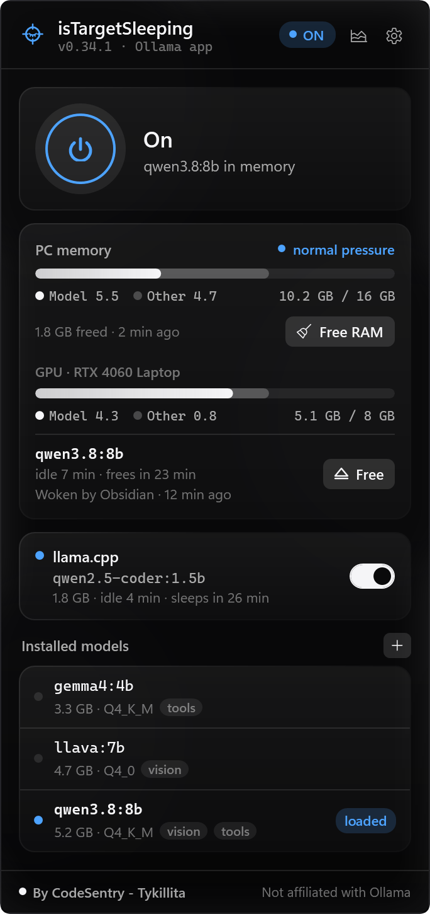
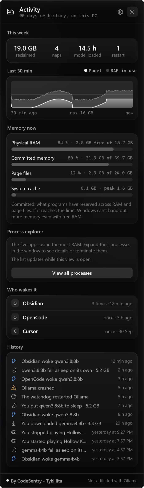
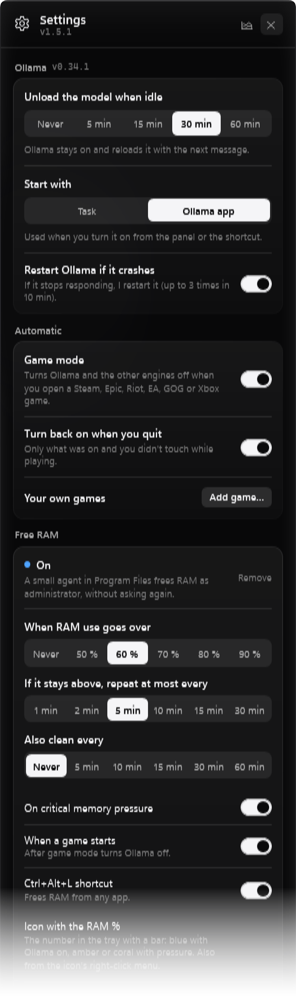
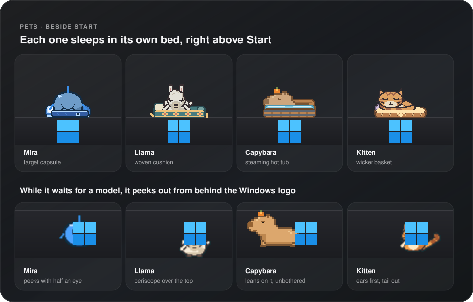
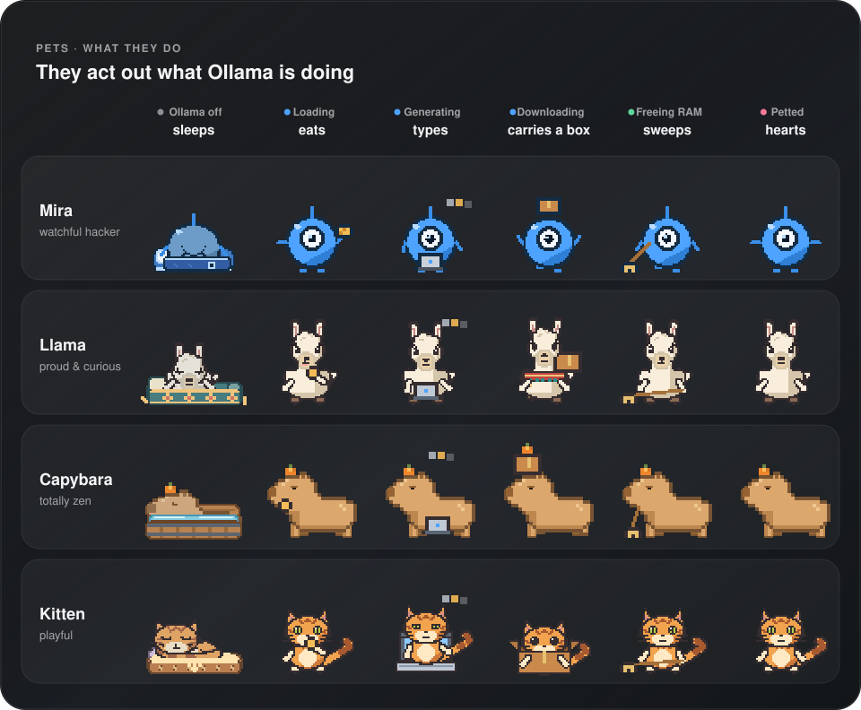
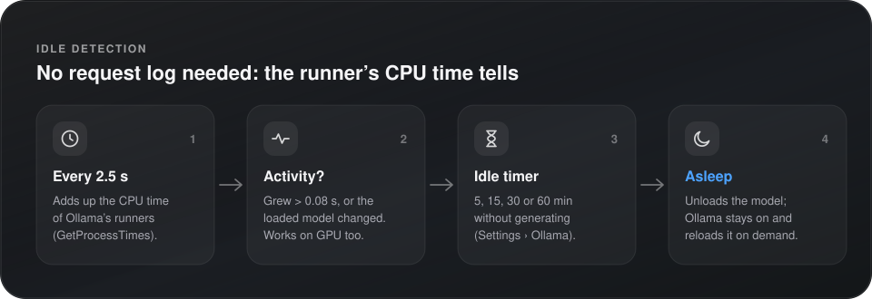
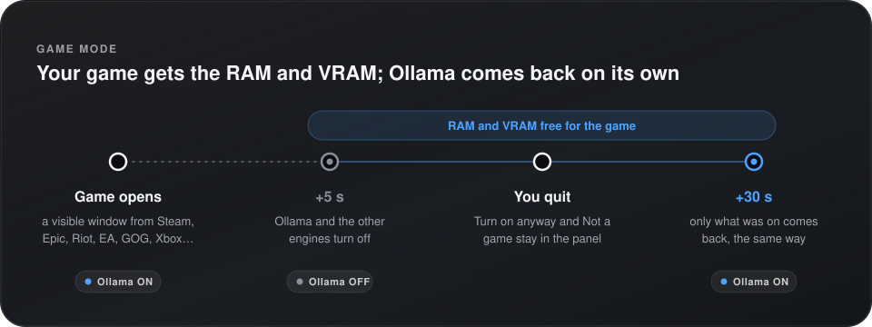

<div align="center">


# isTargetSleeping

**A notch for Windows: Ollama, your PC and your tools, at a glance.**

**English** · [Español](README.es.md)

<!-- The version badge repeats VERSION: update both together. -->
[](CHANGELOG.md)


[](LICENSE)

<br>

&nbsp;&nbsp;&nbsp;&nbsp;<a href="docs/images/settings-en.png"></a>

<p>
  <a href="#video">Video</a> &bull;
  <a href="#-features">Features</a> &bull;
  <a href="#-pets">Pets</a> &bull;
  <a href="#-install">Install</a> &bull;
  <a href="#-usage">Usage</a> &bull;
  <a href="#how-it-works">How it works</a> &bull;
  <a href="#-privacy">Privacy</a> &bull;
  <a href="#development">Development</a> &bull;
  <a href="CONTRIBUTING.md">Contributing</a> &bull;
  <a href="SECURITY.md">Security policy</a>
</p>

<sub>By <b>CodeSentry - Tykillita</b></sub>

</div>

<br>

A native Windows app that lives in the tray or, if you prefer, at the top edge of the screen as a notch. Its first
module is [Ollama](https://ollama.com): it keeps an eye on your local models, puts them to sleep when they stop working
to give you your RAM back, and turns Ollama on and off in one click, however it was installed. The notch adds widgets:
system stats, clock and calendar, Pomodoro, notes and more.

<a id="video"></a>

https://github.com/user-attachments/assets/0265be1e-ccd9-4e39-9741-8e1bd4d3fb88

<p align="center"><sub>The current 1.5.2 app in 77 seconds, with sample data. Unmute for music and sound effects · <a href="https://istargetsleeping.web.app/media/isTargetSleeping-tour-en.mp4">open the video</a> · <a href="https://istargetsleeping.web.app/?lang=en#video">watch on the website</a> · <a href="README.es.md#video">en español</a> · <a href="https://github.com/Tykillita/isTargetSleeping/raw/refs/heads/main/docs/video/isTargetSleeping-tour-en.mp4">download the MP4</a></sub></p>

<p align="center"><sub>Separate Reels edition: 1080 × 1920 (9:16), the same 77-second script and music, larger text, the current pets and visible mouse clicks with sound · <a href="https://istargetsleeping.web.app/media/isTargetSleeping-reel-en.mp4">English MP4</a> · <a href="https://istargetsleeping.web.app/media/isTargetSleeping-reel-es.mp4">MP4 en español</a></sub></p>

## Why?

A 10–30 GB local model stays in memory even when you're not using it. Turning Ollama off isn't obvious either: it
depends on how it was installed, and if you kill the wrong process, it comes right back. **isTargetSleeping** lets
the model sleep when you don't need it and gives you one-click control over Ollama, no terminal required.

## ✨ Features

| | Feature | Details |
|:-:|---|---|
| ⏻ | **Turn on and off** | The big button in the panel, or **Ctrl+Alt+O** from any app. |
| 🔍 | **Detects your install** | The Ollama app, a Windows service (NSSM, WinSW, `sc create`…), a scheduled task or a manual `ollama serve`. It stops Ollama the same way it starts. |
| 🧹 | **Frees idle memory** | After 5, 15, 30 or 60 minutes without generating, it unloads the model. Ollama stays on and reloads it with the next message. **Ctrl+Alt+S** puts it to sleep right now. |
| 🧽 | **Free RAM** | Automatic cleanup when RAM goes over your percentage (repeating after a minimum pause while it stays high), every few minutes or under critical pressure; also with the button or **Ctrl+Alt+L**. Protects models, games and the app you're using. Doesn't need Mem Reduct. |
| 🔎 | **Process explorer** | The **Processes** tab of Activity, inside the notch (or the tray panel): RAM/CPU per application, expandable PIDs, search, filters, sorting, pause and refresh, and forcibly ending an application, process or tree after a confirmation shown right there. |
| 🎮 | **Game mode** | Open a game from Steam, Epic, Riot, EA, GOG, Rockstar or Xbox (or one you add) and Ollama turns off to give it the RAM and VRAM; quit and it comes back the same way. |
| 🛟 | **Watchdog** | If Ollama crashes or hangs, it restarts it with the same mechanism (up to 3 times in 10 minutes). |
| 🔔 | **Notifications** | Native Windows notifications when a model falls asleep, Ollama crashes, memory runs critical, a game starts or a download finishes — each one with its own switch. |
| 📊 | **PC and GPU memory** | RAM in use (same figure as Task Manager), dedicated **VRAM** of your GPU, how much of each is the model, and memory pressure. With several GPUs, Activity lists each one (total, in use, models); a value Windows doesn't provide shows as unavailable. |
| 👀 | **Who wakes it** | Shows which app loaded the model (Obsidian, Cursor, a script…) from its connection to Ollama's port. |
| 📈 | **Activity** | This week: GB reclaimed, naps, hours with a model loaded, restarts; a 30-minute chart, **memory now** (physical RAM, committed memory, page files and system cache, like Mem Reduct) and the latest events. |
| 🗂️ | **Models** | Size, quantization and *vision* / *tools* tags. Load, **download** (with progress, cancellable) or **delete** them from the panel. |
| 🧩 | **Other engines** | A standalone **llama.cpp** `llama-server` gets its own card and idle timer; **LM Studio** is supported experimentally. |
| 🔗 | **Links** | `istargetsleeping://on`, `off`, `toggle`, `sleep`, `load/<model>`… for Stream Deck, PowerToys or scripts. |
| 🎯 | **Status at a glance** | The target in the tray, with a blue, amber or no dot; a radar sweeps while Ollama turns on or off, and the eye opens while a model is loaded. |
| 🐾 | **Pets with personality** | Choose **Mira**, a **llama**, a **capybara** or an **orange kitten**. One lives on the taskbar (above Start, left of Start or walking along it) and acts out what Ollama is doing: sleeps in its own bed, eats while a model loads, types while it generates and cleans up in its own way while freeing RAM. Each one reacts to clicks and to your cursor in its own way — asleep, without leaving its bed. Off by default; [more below](#-pets). |
| 🪟 | **Notch dock** | Optional (Settings > General): a pill docked to the top edge of the screen, on the monitor where your cursor is, showing the three items you choose (status, model and RAM by default; you can also pick the music that is playing, with a playing indicator and a scrolling title). Hover it for a short view you can customize with your own widgets (Ollama by default: status, RAM and GPU, Free RAM, Free model, Processes); click it for the Home. Two icon strips below it give one-click navigation (Home, Widgets and Settings, plus Ollama and Activity if you turn them on) and up to four favorites you choose, with a pin button that keeps the notch open. The panel is solid black at the top and fades into liquid glass (what is behind it, blurred), the dock capsules are glass too, and pressing and dragging across the dock buttons moves a glass lens that opens the page it lands on. It hides while something is full screen. |
| 🧩 | **Widgets** | The notch Home holds four cells that you choose and order on the Widgets page: Ollama, System (CPU, RAM, VRAM, disk, network), Clock and calendar (a month with arrows, an agenda of reminders you add with a draggable day ruler, and the events of an optional .ics file), Pomodoro (with a notice), Keep awake, Notes (saved on their own, locally), Battery and Music (what Windows reports as playing, with bold controls, shuffle and repeat, and the cover's color). Widgets sit straight on the glass, with no cards, in two columns that fill by the shorter one. Everything is read locally. |
| 🎚️ | **Per-app audio and HUDs** | The Audio widget controls and remembers the Windows mixer level for each app with an active audio session. Optional notch HUDs show volume, Caps Lock/Num Lock, brightness on supported internal displays and connected audio endpoints. |
| 🧩 | **Widget editor and system graphs** | Add, drag, reorder and resize compatible Home widgets (up to four cells); save or discard edits. Choose two live system charts from six metrics, or see all six in the wide view. |
| 🤖 | **Coding-agent activity** | Fixed tabs separate active and recent Claude Code and Codex sessions. Recent sessions stay available for 12 hours; search by name, project, agent or activity and filter by agent, project and state with dropdowns styled to match the glass theme. Summaries count completed tool calls and distinct edited files only when paths appear explicitly in the log. Sessions needing attention keep that state and show their idle time. Tool, file and message details expand on request. User prompts, command arguments and full command output are never shown; logs stay on your PC. |
| 📅 | **Calendar, weather, OCR and teleprompter** | Calendar events show progress and meeting links; optional weather looks up a city through Open-Meteo; local OCR copies text from a tray image or screen region; the teleprompter stores its script locally. |
| 🫧 | **More notch controls** | Set the glass fade, hide the notch in chosen apps and use the shared motion style; Windows’ own volume OSD remains available. |

| ⚡ | **Live activities** | In capsules on both sides of the closed notch pill, what is happening now: on the left, Ollama's (freeing RAM, turning on or off, critical memory); on the right, the volume when it changes, a running Pomodoro, Keep awake and, if you turn it on, the music playing. Up to one on the left and two on the right, each with its own switch. The Music widget skips tracks when you swipe it with the mouse or two fingers on the trackpad, and its progress bar is clickable. |
| 📥 | **File tray, clipboard and app favorites** | Drag files or folders onto the notch and they wait on its Tray page (only their paths, in memory) until you drag them back out, copy their path, show them in Explorer or zip them all to the Desktop. Rows show image thumbnails and Material icons for folders, with how many items and how big each folder is; double-click opens an item, a folder can be opened as a project in the Code widget, you can paste files you copied in Explorer, drag everything out at once, and optionally have the tray remembered between sessions (Settings > General, paths only). The optional Clipboard history (Settings > General, off by default) keeps the last 25 texts you copy, in memory only, and skips what password managers mark as private. Text files in the tray can be edited and saved right there (Ctrl+S) for quick changes while you code, and the **Code** widget is a small IDE: pick a folder and get its file tree (with Material Icon Theme icons), tabs, an image viewer and a text editor with syntax colors for Markdown, code, JSON, YAML, XML and more. Favorites can also launch any app or file you pick. |
| ♿ | **Keyboard and screen readers** | Every button and switch is reachable with Tab, shows a focus ring and has an accessible name; the Windows high-contrast theme is followed. |
| 🌍 | **English and Spanish** | Follows the Windows language, or pick one in Settings. |
| 🖤 | **Black glass** | In the tray panel, smoked black glass over Windows 11's real acrylic; in the notch, true black that fades into liquid glass (it blurs what is behind it and tints it so text stays readable). Translucent cards and a monochrome UI with color only for status (and the cover's color for music). The tray icon follows the taskbar mode. |
| 🔄 | **Updates** | Optional and off by default. When enabled, it checks GitHub for stable releases; you choose when to install, and packages are verified with SHA-256 and rolled back if anything fails. The updater accepts the three expected files in the official ZIP. |
| 🔒 | **Private** | Talks to your local model engines. No accounts, telemetry or analytics. Optional update checks and downloads contact GitHub; process data stays on your PC. |
| 🧾 | **Open source** | MIT licensed. |

## 📥 Install

**1.5.0 is out** (October 2, 2026): memory now in Activity, full automatic cleanup rules and renewed pets.

**1.5.2 is out** (October 3, 2026): verified service and task lifecycles with genuine Ollama on Windows. [Validation and limits](docs/backend-validation-1.5.2.md).

**1.6.0 is out** (October 14, 2026): turning Ollama off now closes only the servers it can prove belong to the
selected backend, Activity shows VRAM per GPU, and the panel is reachable by keyboard with accessible names and a
high-contrast theme. It also includes the updater fix: ZIP entries are restricted to the expected files and extraction
stays inside its staging folder. See the [changelog](CHANGELOG.md).

**1.6.1 is out** (October 14, 2026): turning Ollama off also closes the server this app started, even if you then
opened the Ollama app, and freeing RAM no longer makes the watchdog restart Ollama or the pet bounce in and out of
its bed.

**1.25.1 is available** (October 19, 2026): fixes update validation for the official ZIP, which includes the
third-party notices file. If you are updating from 1.25.0 or earlier, download and run the 1.25.1 installer manually
once; the updater in those versions cannot read this package format. [Download 1.25.1](https://github.com/Tykillita/isTargetSleeping/releases/tag/v1.25.1) or see the [changelog](CHANGELOG.md).

**1.25.2 is in development**: the AI Agents recent-session filters now use readable glass-themed dropdowns that stay within their card and match the app's keyboard-focus styling. This version is not available to download yet.

**1.25.0 is available** (October 19, 2026): it brings per-app audio and notch HUDs, a drag-and-drop widget editor with live system charts, local coding-agent sessions with searchable recent history and progressive details, calendar progress and meeting links, optional city weather, local OCR and a saved teleprompter. [Download the Windows release](https://github.com/Tykillita/isTargetSleeping/releases/tag/v1.25.0) or see the [changelog](CHANGELOG.md).

**1.20.0 is out** (October 17, 2026): the notch becomes liquid glass (true black fading into frosted glass, glass dock capsules and a glass lens you drag across the dock), widgets with no cards laid out in two columns, a Music widget tinted with the cover and a calendar with an agenda of local reminders and an optional .ics file, live activities on both sides of the notch, a pin button, Settings and Activity in tabs, and the process explorer inside the notch.

**1.11.0 is out** (October 16, 2026): the music playing in the closed notch pill (with a scrolling title) and a much
better file tray (thumbnails, folder sizes, open as a project, paste, drag all and optional memory between sessions).

**1.10.0 is out** (October 15, 2026): a file tray you drop files onto (with quick text editing), a Code widget
with a file tree, tabs, an image viewer and a syntax-colored editor, an optional clipboard history and app favorites.

**1.9.0 is out** (October 15, 2026): live activities beside the closed notch pill, a Music widget with cover art,
playback controls and a clickable progress bar, and the volume in the notch.

**1.8.0 is out** (October 15, 2026): an optional notch dock at the top of the screen that opens on hover, with a Home
of widgets you choose and order (Ollama, system, clock and calendar, Pomodoro, keep awake, notes, battery) and
favorites you configure. It includes the 1.7.0 notch, which was never published separately.

Downloads are on the [Releases](https://github.com/Tykillita/isTargetSleeping/releases) page.

**Portable:** download `isTargetSleeping-<version>-win-x64.zip` (or `-arm64`), unzip it anywhere and run
`isTargetSleeping.exe`. It's a single self-contained `.exe`: you don't need to install .NET.

**Installer:** `isTargetSleeping-<version>-setup-x64.exe` installs per user in
`%LOCALAPPDATA%\Programs\isTargetSleeping` (no admin).

The first time it opens its panel next to the clock and asks whether to open at login. If you can't see the icon,
it may be in the hidden icons (`^`): turn on **Always show in the taskbar** in the app's Settings › General, drag it
to the taskbar, or turn it on in *Settings › Personalization › Taskbar › Other system tray icons*. If the switch
doesn't appear (Windows 10, or Windows 11 before it registers the icon), Settings › General has a button that
opens the Windows taskbar settings for you.

**Requirements:** Windows 10 (2004+) or 11 · x64 or ARM64 · [Ollama](https://ollama.com/download/windows).

## 🧭 Usage

| Action | Result |
|---|---|
| **Click** the tray icon | Opens the panel (click outside or press Esc to close it) |
| **Drag** the panel's header | Moves it; it opens there from then on. **Double-click** the header to put it back by the tray |
| **Right-click** | Turn on/off, put the model to sleep, activity, view the Ollama log, open at login, *About*, quit |
| **Ctrl+Alt+O** | Turns Ollama on or off from any app |
| **Ctrl+Alt+S** | Puts the model to sleep (and the other engines' models) without turning anything off |
| **Ctrl+Alt+L** | Frees RAM (once the memory agent is on) |
| **Click a notification** | Opens the panel |

The panel has three views: the main one, **Activity** (chart icon) and **Settings** (gear), which scroll if they
don't fit on screen.

**Settings:** *Ollama* — unload when idle, which mechanism to start it with, restart it if it crashes ·
*Automatic* — game mode, turn back on when you quit, your own games · *Notifications* — one switch per kind ·
*Integrations* — the links, ready to copy · *Other engines* — each engine's idle timer · *General* — both shortcuts,
open at login, always show in the taskbar, tray animation, pet, update checks, language · logs.

### 🐾 Pets

<p align="center"></p>

Turn on **Pet beside Start** in Settings › General (or the tray menu) and one pet moves into your taskbar. It's drawn
pixel by pixel on its own layered window, crisp at any DPI, and lives in one of three places: **above Start**,
**inside the taskbar left of Start** (touching the Windows logo) or **walking** along the taskbar up to the tray while
a model is awake. Pick it from the two-column picker in Settings or from its right-click menu; the choice is saved
and changes without restarting.

**It acts out what Ollama is doing:**

<p align="center"></p>

<details>
<summary>See as a table</summary>

| Ollama | The pet |
|---|---|
| Off | Sleeps in its bed, with Z's |
| Starting · stopping | Stretches and wakes up · yawns and goes back to bed |
| On, no model | Dozes — or hides behind the Windows logo and peeks out |
| Loading a model | Eats a snack |
| Model in memory | Stands alert, with idle gestures of its own |
| Generating | Types on a tiny laptop |
| Downloading a model | Carries a box |
| Freeing RAM | Cleans up in its own way (see below); if it was asleep it gets out of bed first, and goes back afterwards |
| High · critical memory pressure | Sweats · turns coral |

</details>

One-shot reactions: sparkles when RAM is freed, a nap when the model goes to sleep, dizzy stars when Ollama crashes
(sad if the watchdog gives up), a jump when clicked and hearts when you pet it (move the mouse back and forth over it).
The sparkles close the cleanup: they arrive once it has been seen cleaning, wherever it is. **Asleep, it reacts without
leaving its bed** — an eye half opens, an ear twitches, a bubble, a snort or a purr — and the Windows logo stays dark.

**Each one has its own personality:**

| Pet | Character | Signature moves | Bed |
|---|---|---|---|
| **Mira** | Watchful hacker — the app's own logo come to life | Sweeps a radar ring from her eye, locks a red reticle on your cursor, her antenna sends signals and bits rise while she works; a click is a radar *ping*; a robot, she boots up calibrating her eye and cleans by scanning the taskbar with a beam from her eye, pulling the loose data towards her and compacting it into a cube that bursts into sparkles | Blue target capsule |
| **Llama** | Proud, curious, a bit dramatic | No arms: she speaks with her neck, ears, hooves and woolly tail. Trots head-high, chews sideways with the food in her muzzle, types by pecking the laptop to the beat of her hooves, hums, stretches her neck toward the cursor, carries the box under a woven blanket and snorts a little cloud when clicked; shakes the dust out of her wool to clean; peeks over the logo like a periscope | Andean woven cushion |
| **Capybara** | Zen | Barely flinches (a slow blink and a bubble), a bird lands on her back, balances the box on her head with the mandarin on top; with nothing to do she sits; while Ollama starts her crocodile arrives, she jumps on standing, sits on its back for the ride and hops off once it's on (the ride always finishes); to clean she scoots her bottom along the floor and ends up sparkling (if she was asleep, she climbs out of her tub and wrings out her fur instead); doesn't hide — she leans on the logo | Steaming wooden hot tub |
| **Orange kitten** | Playful | Crouches with dilated pupils when hovered, pounces if the cursor stays still for 1.2 s, puffs up and swipes when clicked, grooms, kneads with purrs; a cat doesn't sweep — it washes itself; shows her ears first when peeking, tail sticking out | Padded wicker basket |

**The Windows logo joins in** as part of its home: a second click-through window paints "lights" over the real logo,
pane by pane. With Ollama off it stays exactly as Windows draws it; with Ollama on it glows softly, the glow arrives
pane by pane as Ollama starts, a pane flashes with each keystroke while the model generates, the panes fill up like a
progress bar while downloading and it glows amber while a model loads. Clicks still go to Start.

**It stays out of the way.** Only its silhouette takes clicks (click: panel, right-click: its menu) and it never takes
focus; turn off *Interact with the pet* and every click passes through. It hides instantly when Start, Search, a game
or a full-screen app opens, and with an auto-hiding taskbar. If Windows doesn't expose the Start button it stays hidden
and Settings explains why. **Reduced motion** uses one still pose per state and species, with no animation timers.
Turning the switch off closes its window and stops its timers.

To review animations without changing preferences, `--export-pet directory` writes sheets for all four species on
light and dark backgrounds: every state, transition (including cleaning from bed and awake), idle gesture (with its
particles), mouse reaction, every reaction standing and in bed, the end of a cleanup, both walking directions, reduced
motion and a collection overview with the beds. `--snapshot output.png pet --pet llama` previews
one species; the IDs are `mira`, `llama`, `capybara` and `orange-cat`.

### Links

| Link | Does |
|---|---|
| `istargetsleeping://on` · `off` · `toggle` | Turns Ollama on / off / the opposite |
| `istargetsleeping://sleep` | Puts the loaded models to sleep |
| `istargetsleeping://clean` | Frees RAM |
| `istargetsleeping://load/llama3.2` | Loads a model (URL-encode names with `/`) |
| `istargetsleeping://show` · `activity` | Opens the panel / the Activity view |

They are registered per user under `HKCU\Software\Classes\istargetsleeping` (no admin) every time the app starts.
From PowerShell: `start istargetsleeping://sleep`. If the app isn't running, the link starts it.

<a id="how-it-works"></a>

## ⚙️ How it works

### Stopping Ollama the right way

| If Ollama comes from… | Stop | Start | Verified |
|---|---|---|:-:|
| **Ollama app** (ollama.com installer) | Asks its windows to close and ends its process tree after 2 s, including any `ollama serve` it started | `ollama app.exe hidden` (tray only, no chat window — the same flag Ollama uses at login) | ✅ 0.34.1 / 0.34.4 / 0.35.0 |
| **Windows service** wrapping Ollama | Service Control Manager stop | SCM start | ✅ Windows Server 2025 x64 VM · Ollama 0.35.1 |
| **Scheduled task** running `ollama serve` | Task Scheduler `Stop`, then ends what is left of that task's own process (not other tasks) | Task Scheduler `Run` | ✅ Windows Server 2025 x64 VM · Ollama 0.35.1 |
| **Manual `ollama serve`** | Ends the server the app started (remembered by PID and start time); one you launched yourself is left running | Launches `ollama serve` detached, logging to `%LOCALAPPDATA%\isTargetSleeping\Logs\ollama.log` | ✅ |
| **Not installed** | — | Opens ollama.com/download | ✅ |

Service and task verification uses the actual 1.5.2 executable and genuine Ollama: two start/stop cycles,
API state, process identities, repeated actions and fixture cleanup. The service uses a native SCM test host
under LocalService; the task runs under SYSTEM. No models were loaded. This covers those configurations on a
Windows VM; physical GPUs, every third-party service wrapper and interactive UAC remain outside its scope.
See the [bilingual validation report](docs/backend-validation-1.5.2.md) and
[reproducible integration checks](tests/BackendIntegration/README.md).

Only servers that can be proven to belong to the selected backend are closed. If another `ollama serve` is still
running afterwards — another task, or one started by hand — it is left alone and the app reports an incomplete
shutdown instead of ending it. The `tests/BackendIntegration/isolation` check exercises this with a stand-in
`ollama.exe` (two scheduled tasks and a manual server); it does not use the real Ollama.

A service usually needs admin rights to be started or stopped: isTargetSleeping runs as a normal user and only asks
for elevation (UAC) for that one `sc start/stop`. A service's restart-on-failure policy doesn't kick in, because the
stop goes through the SCM.

Detection order: running Ollama app → running service → running task → standalone `ollama serve` → whatever is
installed. While Ollama is off, it uses the one picked in Settings or, failing that, the last one it was running
with (remembered across launches).

### Detecting an idle model

Ollama doesn't expose when the last request happened. Each loaded model runs in a runner process that only uses CPU
while it's working. On Windows the runner is `lib\ollama\llama-server.exe` (Ollama 0.34+), `ollama.exe runner` or
the older `ollama_llama_server.exe`; isTargetSleeping recognizes all three.

<p align="center"></p>

| Measurement (Ollama 0.34, gemma-4 E2B, RTX 4060 Laptop) | Runner CPU time |
|---|---:|
| Idle, per 2.5 s sample | +0.008 s |
| Generating a short answer | +50 s |

Every 2.5 s the app adds up the runners' CPU time (`GetProcessTimes`). If it grows by more than **0.08 s**, or the
loaded model changes, that counts as activity — and it holds even when the model runs entirely on the GPU. The logic
is in [`IdleTracker`](src/IsTargetSleeping/Core/Activity.cs), covered by tests.

### Memory

With a dedicated GPU, Ollama reports the whole model as VRAM, yet the runner still reserves gigabytes of system RAM
(CUDA host buffers, context). So the *Model* part of the bar is the runner's own private memory, read from the
process; the model line also shows how much sits on the GPU. *In use* matches Task Manager, and the total is the
installed RAM (16 GB, not the 15.7 GB usable). Pressure turns amber above 85 % load and red when Windows signals low
memory; entering *critical* sends one notification until it goes back to normal.

The **GPU** bar picks the adapter with the most dedicated memory (via DXGI, so a laptop's RTX, not the integrated
graphics) and reads `\GPU Adapter Memory(*)\Dedicated Usage` and `\GPU Process Memory(*)\Dedicated Usage` — the same
counters Task Manager uses. The runners' VRAM is the model's share. It's hidden when there's no dedicated GPU.

Activity's **Memory now** separates physical RAM, committed memory, page files and system cache (current/peak).
Committed memory is what programs have reserved across RAM and page files; reaching its limit can prevent new
allocations even with physical RAM available. Each measurement has its own bar.

### Freeing RAM (instead of Mem Reduct)

Every cleanup — automatic or manual — cleans the areas selected in Settings. The automatic rules are independent:

- **Percentage:** when RAM use reaches the percentage you set (say 70 %), it cleans right away, even if the interval
  hasn't come around. While it stays above, it repeats at most every *minimum pause* (1–30 min, 5 by default).
- **Interval:** every N minutes since the last cleanup of any kind, whatever the RAM use.
- **Critical pressure:** acts as soon as Windows reports it and, if it persists, repeats after the minimum pause.
- **When a game starts:** after Ollama and the other engines confirm they're off (up to thirty seconds).

None of them waits for Windows to report high pressure: your percentage rules. At least a minute separates two
attempts; a failed attempt retries after 3, 6, 15 and then every 30 minutes. Models, engines, the active game and the app
you're using (with its child processes) are protected; when the taskbar, tray or desktop is in front, only Explorer
itself is protected, not everything opened from Start. Protected Windows processes that deny access even to
administrators are skipped.

The areas match Mem Reduct's, including these advanced operations:

| Area | How | Default |
|---|---|:-:|
| Apps' working sets | `EmptyWorkingSet` **per process**, skipping protected applications and descendants | ✅ |
| System file cache | `NtSetSystemInformation(SystemFileCacheInformationEx)` | ✅ |
| Low-priority standby list | `SystemMemoryListInformation` → `MemoryPurgeLowPriorityStandbyList` | ✅ |
| Full standby list | → `MemoryPurgeStandbyList` (slow: Windows reads it back from disk) | ⬜ |
| Modified page list | → `MemoryFlushModifiedList` | ⬜ |
| Combine identical pages | `SystemCombinePhysicalMemoryInformation` (Windows 10+) | ✅ |
| Registry cache | `SystemRegistryReconciliationInformation` (Windows 8.1+) | ✅ |
| Modified file cache | `FlushFileBuffers` on each fixed volume | ✅ |

The defaults are Mem Reduct's (`ReductMask2 = 0xE7`) and the bits are the same. Mem Reduct isn't needed: if you still
have it, uninstall it or turn its auto-clean off so the two don't clean at once.
The panel distinguishes success, partial completion, failure and no work. Memory is observed before cleanup,
immediately afterward and at five/thirty seconds; changes can be negative and include other activity on the PC.
Weekly cleanup totals use the five-second observation. These values describe an observed change, rather than a
guarantee of sustained savings or faster applications. Standby memory is already available to Windows.

**Administrator rights, once.** These calls need admin, and isTargetSleeping runs as a normal user. *Turn on* in
Settings › Free RAM extracts a separate program, `isTargetSleeping.MemoryAgent.exe`, and runs it with UAC once:
it copies itself to `C:\Program Files\isTargetSleeping\cleaner`
(only admins can write there, so the elevated task never runs code a normal process could replace) and registers the
task `\isTargetSleeping\Liberar RAM` — no triggers, highest privileges, your user only. Each cleanup starts that task
with a strictly validated request ID and process identities. Its report is written atomically in the protected
agent folder. Cleanup and process actions are serialized, and a still-running cleanup remains pending instead of
allowing another request. *Remove* (or the uninstaller) deletes the task and the folder. Update an older agent from
Settings before using the new operations.

### Recognizing and ending processes

**Activity › Processes** (also reached from every **View all processes** button) lists the applications using
RAM inside the notch, or the tray panel, with RAM, physical RAM share, CPU, user and status, grouped by executable path, owner and session.
Expand an application to see each PID, path, parent and committed memory. Search name, executable, path or PID;
filter windowed/background/system/protected applications and minimum RAM; sort RAM, CPU, name, count or PID.
On supported Windows versions RAM is **private resident RAM**; older versions explicitly show **total resident
RAM**. Unreadable metrics stay unavailable and process totals can differ from global RAM.

The list updates every two seconds only while the tab is visible, and has **Pause** and
**Refresh**. Sorting persists (press the active criterion to reverse it); searches and filters do not. Queries and normal termination work
without installing the agent.

**End application** targets its grouped processes and descendants. **End process** targets only the selected PID;
**End process tree** includes its descendants. Each forced close shows its confirmation right there, with the exact list of PIDs and memory, and can lose unsaved work.
Critical Windows processes and isTargetSleeping/its agent are blocked. Creation-time validation and individual
exit checks protect against PID reuse and report partial failures. Access denied offers **Retry as administrator**
with its own UAC prompt and a separate agent command; the cleanup task cannot terminate arbitrary processes.
Managed servers ended here stay manually stopped. External services may restart a process; the inspector
identifies it without disabling services or startup entries.

### Watchdog

| Situation | What it sees | What it does |
|---|---|---|
| **Crash** | Ollama should be on, the API doesn't answer and no `ollama serve` is alive for 2 samples (~5 s) | Restarts it with the last mechanism |
| **Hang** | `ollama serve` is alive but the API doesn't answer for 3 samples (~7.5 s) | Kills it and restarts it |
| **You turned it off**, or quit the Ollama app from its own menu | — | Nothing |

At most 3 restarts in 10 minutes; after that it gives up, tells you, and doesn't insist until Ollama answers again.
It never acts during game mode. Measured: a killed `ollama serve` is answering again in ~8–10 s. (The Ollama app
sometimes relaunches its own server first — that's why it waits two samples.)

### Game mode

<p align="center"></p>

Every 2.5 s it looks for a process **with a visible window** whose `.exe` lives in a game library: Steam (every
library in `libraryfolders.vdf`), Epic (its `.item` manifests), `C:\Riot Games`, EA Games, Rockstar Games, GOG (its
registry keys), `XboxGames` on any drive, plus the games you add in Settings. Launchers, crash reporters, anti-cheat
and helpers don't count, nor does Wallpaper Engine. A game in exclusive Direct3D full screen counts too.

It enters after the game has been open for **5 s** and leaves **30 s** after you quit (so a restarting game doesn't
make Ollama flicker). On entering it turns off Ollama and the other engines that were on, remembering how; on leaving
it turns back on only those. If you turn Ollama on by hand while playing, that is respected until you quit. The panel
shows *Playing X* with **Turn on anyway** and **Not a game** (which ignores that `.exe` from then on).

### Who wakes the model

Every second the app reads Windows' TCP table (`GetExtendedTcpTable`, which includes the owning process) and notes
which processes have a connection to Ollama's port. When a model appears in memory, it's attributed to the apps seen
in the last 10 seconds, named from their `.exe` (product name, or the description for Windows' own programs) and shown
with their icon. Loads from the panel itself don't count.

### Other engines

- **llama.cpp** (tested): any `llama-server.exe` that Ollama didn't launch — Ollama's own runners are recognized by
  their parent process (`ollama.exe`) or, if the parent is gone, by the flags Ollama uses (`--no-webui --offline`).
  Port from `--port` (8080 by default), health from `/health`, the model from `/props` (Ollama blobs are shown with
  their Ollama name), activity from `/slots` plus CPU time, memory = private RAM + VRAM. llama-server can't unload
  its model without exiting, so *sleep* stops the process and remembers its exact command line; *on* relaunches it
  the same way (log in `Logs\llama-server.log`).
- **LM Studio** (**experimental, not tested on real hardware**): shown only if `lms.exe` is installed; server on port
  1234, `GET /api/v0/models` for the loaded models, `lms server start|stop` and `lms unload --all`; activity is
  measured from apps connected to its port.

### Updates

The official public repository, **Tykillita/isTargetSleeping**, is configured by default. Automatic checks are optional and off by default; when enabled, they run at startup and every 24 hours. Existing explicit preferences,
including `updateCheck: false` and custom `updateRepo`, are preserved. **Check for updates now** in Settings and the
tray menu works even with automatic checks off. GitHub rate-limit waiting times are respected.

Only newer stable releases are offered, using the ZIP and SHA-256 for the process architecture (x64 or ARM64).
The panel shows your current version, the new version and **Release notes**. Nothing installs until you click
**Update**. Downloads show progress and can be cancelled; packages are checked for SHA-256, and ZIPs can contain
only the expected executable, `LICENSE` and `THIRD-PARTY-NOTICES.md`. Those entries map to fixed filenames, and
extraction is checked to stay inside its staging folder. The expected executable's architecture/version is checked
too. A background copy of the app waits for normal shutdown, replaces the executable in its current location and keeps a backup until the new tray
starts. Failed replacement/startup
restores and reopens the previous version. Settings and history are preserved. Without folder write permission,
the app offers a manual GitHub download. Updating the memory agent remains a separate action with its UAC prompt.

Installations from before 1.3.0 without an update repository need one manual upgrade to receive later offers.

## 🔒 Privacy

- It only connects to Ollama's local API (`127.0.0.1:11434`, or `OLLAMA_HOST` if set, including the user-level
  environment variable) and, for other engines, to their local ports.
- When enabled, automatic update checks contact `api.github.com` at startup and every
  24 hours without credentials. Clicking **Update** downloads the package and checksum from GitHub, including
  GitHub's `release-assets.githubusercontent.com`/`objects.githubusercontent.com` download hosts. These requests
  expose your IP and app user agent to GitHub; no models, prompts, settings or usage history are uploaded.
- The agent uses administrator rights for enabled RAM cleanup and explicitly confirmed
  process-termination retries. Each elevated termination requires its own UAC approval.
- Process names, PIDs, paths, users and memory/CPU metrics are read locally; the inspector sends none of them to
  an external service.
- The notch widgets read your PC locally (CPU, memory, disk and network counters, battery, clock) and send nothing
  anywhere. Notes are plain text in `%LOCALAPPDATA%\isTargetSleeping\notes.txt`; Keep awake asks Windows not to
  sleep until you turn it off or quit.
- The notch's liquid glass copies the screen area behind the open notch once each time it opens, reduces it to a few dozen
  colored cells in memory and never saves it or sends it anywhere. Calendar reminders are saved in `settings.json`; the
  optional `.ics` file is only read from the path you pick (only the path is saved) and nothing is sent: no accounts, no network.
- The Music widget and the "Music playing" live activity read the media session Windows exposes (title, artist, cover art)
  locally and only while one of them is in use; nothing is stored or sent.
- The file tray keeps only the paths of what you drop (never copies), in memory unless you ask it to remember them between sessions (then only the paths go to `settings.json`); a .zip is written only when you ask for
  it, on your Desktop. The optional clipboard history (off by default) keeps up to 25 copied texts in memory only: never
  on disk, never images or files, skipping what password managers flag as private, and it is emptied when you turn it
  off or quit. A favorite app stores just its path in `settings.json`, and so does the Code widget's folder; it only reads and writes the files you open there. The tray editor works on the file in place: it keeps its encoding and line endings, saves through a temporary file and warns instead of overwriting a file that changed on disk; text you have not saved lives only in memory.
- Per-app audio, system metrics, keyboard state, brightness and audio endpoint detection are read locally. Audio levels are the same controls exposed by the Windows mixer.
- The optional agent widget reads local Claude Code and Codex CLI logs read-only. Recent sessions retain finished sessions and sessions idle for five minutes for up to 12 hours; sessions needing attention keep that label and show elapsed idle time. Counts use completed calls and explicit file paths. Short messages, tools and files appear only in expanded details. User prompts, command arguments and full command output are never shown, and no log data is sent anywhere.
- Weather is off by default. When enabled, the city you choose is sent to Open-Meteo for geocoding and forecasts; Windows location is not requested. OCR runs locally and copies recognized text to the clipboard. Teleprompter text is saved in local settings.

- No accounts, telemetry or analytics. Web pages open only when clicked: Ollama downloads, credits and GitHub
  release notes/downloads.
- Settings live in `%LOCALAPPDATA%\isTargetSleeping\settings.json`, the 90-day history in `stats.json` next to it and
  its own log in `Logs\app.log` (notifications, restarts, game mode). "Open at login" is the usual
  `HKCU\…\CurrentVersion\Run` entry (and it respects Task Manager's *Startup apps* switch); the links are
  `HKCU\Software\Classes\istargetsleeping`. The installer removes both.

<a id="development"></a>

## 🛠️ Development

100 % native Windows: C# on .NET 10 with **WPF** for the interface and **Win32** directly (P/Invoke) for everything
else — `Shell_NotifyIcon`, `RegisterHotKey`, `GlobalMemoryStatusEx`, `GetProcessTimes`, `NtQueryInformationProcess`,
the Service Control Manager, Task Scheduler (COM), DWM for the acrylic glass and rounded corners, DXGI (through its
COM method table) and PDH for the GPU, `GetExtendedTcpTable`, `SHQueryUserNotificationState` and `WM_COPYDATA` between
instances. No NuGet packages, no WinForms, no web view.

**Requirements:** .NET 10 SDK (`winget install Microsoft.DotNet.SDK.10`) · optional: Inno Setup 6 for the installer.

```powershell
.\build.ps1                    # build\isTargetSleeping.exe (self-contained, single file)
.\build.ps1 -Install           # also installs it in %LOCALAPPDATA%\Programs\isTargetSleeping and relaunches it
.\build.ps1 -Test              # logic, native integration and WPF tests (see below)
.\package.ps1                  # dist\: zip + installer for x64 and arm64, with .sha256
.\package.ps1 -RequireInstaller # fail if Inno Setup is missing
.\docs\generate-images.ps1     # this README's images and the logo assets
```

The website uses the same media sources as this README. The bilingual video preserves the original
eleven scenes, script, transitions, animation timing and soundtrack, with current pets and native 4×
app captures. Install the optional media tools, Chrome and the .NET 10 SDK, then run:

```powershell
python -m pip install --target obj/tour-tooling Pillow numpy imageio-ffmpeg==0.6.0
npm install --prefix obj/tour-tooling puppeteer-core@25.12.0
python docs/generate-tours.py --capture
pwsh -NoProfile -File site/build.ps1 -Out _site
```

The 1080p tour uses lossless input frames and copies the original audio without re-encoding. See the
[presentation sources and review commands](docs/tour/README.md). `_site/` is generated and ignored by Git;
Firebase publishes it with content hashes in media URLs so browsers receive updated assets. Edit the sources
in `site/`, `Assets/` and `docs/`, then rebuild.

### Preparing a GitHub release

Set `VERSION` to a stable `MAJOR.MINOR.PATCH` and add its `## [version]` section to `CHANGELOG.md`. Run
`.\build.ps1 -Test`, then `.\package.ps1 -RequireInstaller` and
`.\packaging\verify-release.ps1 -Tag v<version> -VerifyAssets`. Commit the sources and push the matching tag.
The `prepare-release` workflow repeats validation and tests, ensures Inno Setup 6 is available, builds both
architectures, verifies all eight assets/hashes, and creates a **draft** containing the changelog notes. Review
the packages and publish that draft in GitHub. The app cannot see drafts or prereleases. The existing `main`/PR
build checks continue to run. Only the draft-creation job has `contents: write`; clients need no token.

Optional signing uses the existing `SIGN_CERT_THUMBPRINT` mechanism for local builds. Unsigned releases are supported.

Keep only the eight files for the version being verified in the assets folder. If `dist` contains older packages,
copy the current eight to a separate folder and pass `-AssetsDirectory <folder>` to `verify-release.ps1`.
The [1.5.0 preparation record](docs/release-1.5.0.md) lists the validation it went through.

Set `SIGN_CERT_THUMBPRINT` before `package.ps1` to sign the `.exe` and the installer with `signtool`; unsigned
builds trigger SmartScreen.

### Command line

```powershell
$B = "$env:LOCALAPPDATA\Programs\isTargetSleeping\isTargetSleeping.exe"
& $B --status | Write-Output    # detected mechanism, whether the API responds, llama-server processes
& $B --on | Write-Output        # same path as the panel button (also --off)
& $B --sleep | Write-Output     # puts the models to sleep (through the running app if there is one)
& $B --clean | Write-Output     # frees RAM through the memory agent (same rules for protected processes)
& $B --url istargetsleeping://load/llama3.2
& $B --memory | Write-Output    # PC memory, runner CPU time and GPU memory
& $B --idle-test 20 | Write-Output   # tests auto-free with a 20 s limit
& $B --snapshot panel.png settings demo --lang en   # also: activity, game
& $B --export-logo .\out        # .ico, PNGs and SVGs from the logo geometry
& $B --export-tray .\out        # every tray-icon animation frame at 16–32 px, dark and light taskbar
& $B --export-pet .\out         # every pet animation frame at 100 % and 150 %, dark and light taskbar
```

It's a windowed app, so pipe its output (`| Write-Output`) for PowerShell to wait for it.

### Tests

`.\build.ps1 -Test` runs the logic/native and WPF test benches (no test framework): `IdleTracker`, the watchdog
(crash, hang, restart limit, manual off), `GameModeTracker` (debounce, restoring only what was on, manual override),
the `libraryfolders.vdf` and Epic manifest parsers, `ClientTracker` (10-second window), `StatsStore` aggregates and
persistence, `/api/pull` NDJSON progress, `istargetsleeping://` links, and the updater — version comparison, release
parsing, and a full download + SHA-256 check + `.exe` swap against a local HTTP server on `127.0.0.1` (nothing
leaves the PC); the memory agent's protocol and reports, cleaning rules, memory breakdown and pet animations.
Process tests cover grouping, PID reuse, protected processes and actual termination of test-created descendants.
WPF tests cover both languages, filtering, stable selection, virtualization and pausing sampling when hidden.
Settings and history compatibility are checked. These tests do not install the agent or clean the user's RAM.

### Project layout

```text
src/IsTargetSleeping/
├── Program.cs              Entry point, single instance, forwards links and --sleep to the running app
├── App.xaml(.cs)           Styles, tray, animated icon, right-click menu, hotkeys
├── Cli.cs                  --status, --on, --off, --sleep, --clean, --memory, --idle-test, --snapshot, --export-logo, --export-tray, --export-pet
├── Core/
│   ├── Backend.cs          Mechanism detection (app, service, task, binary) and on/off
│   ├── OllamaApi.cs        Ollama's HTTP API, pull (NDJSON progress) and delete
│   ├── OllamaController.cs State for the interface, polling, idle auto-free, watchdog, downloads
│   ├── Supervisor.cs       Game mode, other engines, notifications, pressure, links, updates
│   ├── Supervisor.Clean.cs Freeing RAM: rules and agent
│   ├── MemoryAgent.cs      Agent installation, scheduled task and versioned operation reports
│   ├── MemoryBreakdown.cs  Physical/committed memory, page files and system cache
│   ├── ProcessContracts.cs Shared identities, snapshots and action results
│   ├── ProcessMonitoring.cs Native process sampling and protection detection
│   ├── ProcessActions.cs   Verified process/tree termination
│   ├── CleanSpec.cs        Cleaning areas and the agent's order format (shared with the agent)
│   ├── CleanRules.cs       When to clean automatically (pure logic)
│   ├── Watchdog.cs         Crash and hang detection (pure logic)
│   ├── TrayMotion.cs       Tray icon animations: which one plays and each frame's pose (pure logic)
│   ├── Games.cs            Game libraries, game detector and GameModeTracker
│   ├── Clients.cs          TCP connections per process, app names and ClientTracker
│   ├── Stats.cs            90-day history, weekly figures, 30-minute samples
│   ├── Gpu.cs              DXGI adapter and PDH VRAM counters
│   ├── Links.cs            istargetsleeping:// parsing and registration
│   ├── Updater.cs          GitHub release states, verified/cancellable downloads
│   ├── UpdateInstaller.cs  Background helper, startup confirmation and backup recovery
│   ├── Engines/            IEngine, llama.cpp and LM Studio (experimental)
│   ├── Activity.cs         Runner CPU time, runner memory and IdleTracker
│   ├── SystemMemory.cs     Memory in use and pressure
│   ├── Processes.cs        Processes by name, command line and parent
│   ├── Prefs.cs            Hotkeys, open at login, preferences
│   ├── Paths.cs            App identity, paths, settings store, app log
│   ├── L10n.cs             Translations (Spanish keys)
│   └── Win32.cs            Windows API calls
├── UI/
│   ├── ContentView.xaml    Main view, Activity and Settings
│   ├── PanelViewModel.cs   Everything the panel shows, computed from the state
│   ├── PanelWindow.cs      The tray flyout (the body scrolls within ~75 % of the screen)
│   ├── ProcessWindow.cs    Process explorer and termination confirmations
│   ├── TrayIcon.cs         Notification-area icon, notifications, WM_COPYDATA
│   ├── TrayAnimator.cs     Plays the tray animations at 20 fps, with the radar frames cached
│   ├── TaskbarPet.cs       The pet: state, animation, position, mouse and its menu
│   ├── PetSurface.cs · TaskbarLocator.cs   Its layered window; Start, tray and foreground tracking
│   ├── Pets/               The pet collection (IPetSpecies, PetCatalog), Mira on a pixel grid, the Windows logo lights
│   ├── Notifier.cs         Per-kind switches and the 1-per-minute limit
│   ├── Logo.cs             The target-with-a-sleeping-eye logo (icon, tray, header, SVG)
│   ├── Controls.cs         Switch, memory bar, 30-minute chart, spinner, app icons
│   ├── Theme.cs · Glass.cs · Mark.cs · AboutWindow.cs
└── Resources/Strings.en.json
src/IsTargetSleeping.Agent/    The memory agent: the only code that runs as administrator
tests/IsTargetSleeping.Tests   Logic and native integration tests
tests/IsTargetSleeping.UiTests WPF interface tests
packaging/isTargetSleeping.iss Inno Setup installer
Assets/                        Icon (.ico), PNG and SVG logo
```

## Credits

**By CodeSentry - Tykillita.** CodeSentry is the software development and cybersecurity company of Ruben Pino
(Tykillita).

isTargetSleeping is based on the **idea** of [ModelNap](https://github.com/eriktaveras/modelnap) by Erik Taveras
(Taveras Solutions LLC, MIT License) — a small app that puts idle Ollama models to sleep. isTargetSleeping has been
**completely redesigned**: a native Windows app with its own identity and black-glass interface, and **new, original
features** such as game mode, the Ollama watchdog, RAM cleaning that protects the models
(replacing Mem Reduct), GPU/VRAM usage, "who wakes the model", the Activity view with its history, downloading and
deleting models, llama.cpp and LM Studio, `istargetsleeping://` links, notifications and updates. ModelNap's copyright
notice is kept in [LICENSE](LICENSE), as its MIT License requires.

The Code widget's file icons come from [Material Icon Theme](https://github.com/material-extensions/vscode-material-icon-theme) (MIT) and its text editor is [AvalonEdit](https://github.com/icsharpcode/AvalonEdit) (MIT); see [THIRD-PARTY-NOTICES.md](THIRD-PARTY-NOTICES.md).

Ollama is a trademark of its respective owners; this project is not affiliated with Ollama.

---

<p align="center"><em>Your model sleeps. Your RAM comes back. Your pet keeps watch.</em></p>
