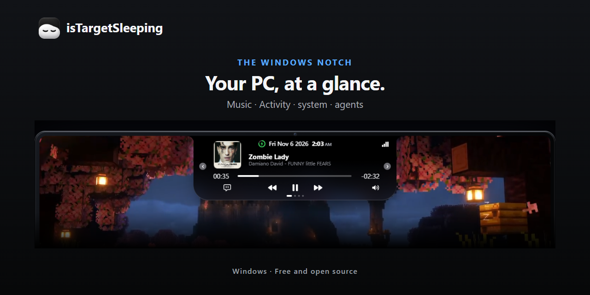
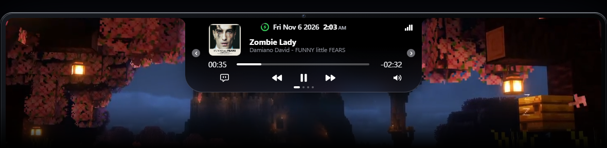
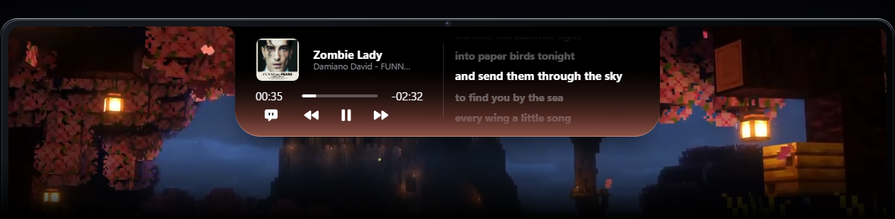
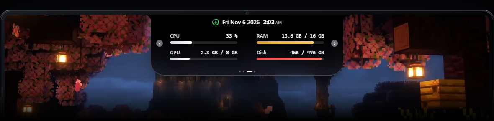
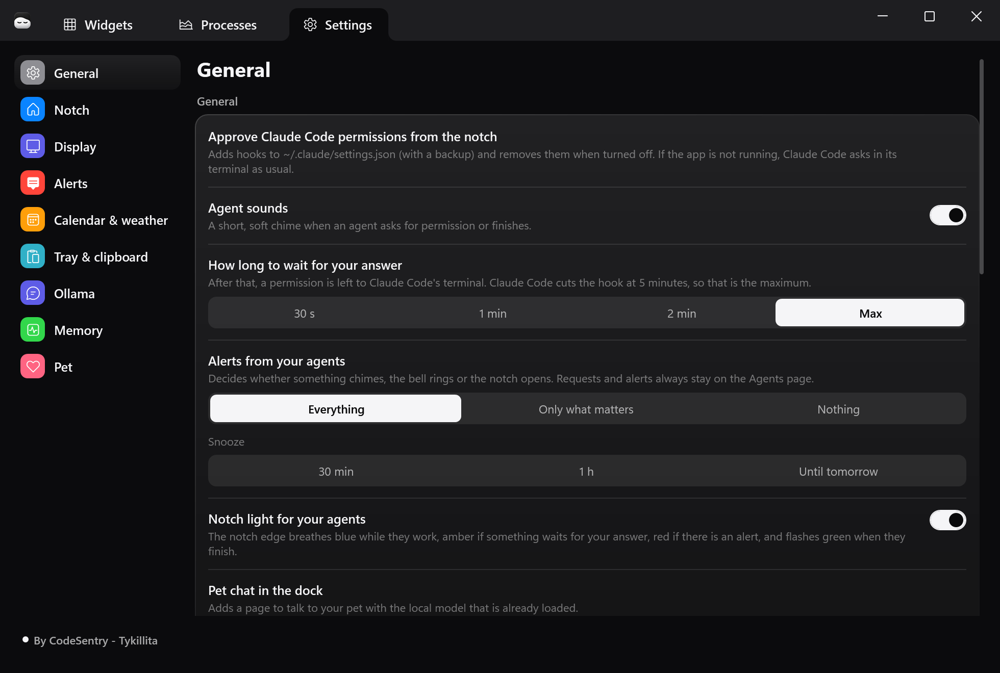

<strong>THE WINDOWS NOTCH FOR YOUR PC</strong>

# isTargetSleeping

<strong>Music, Activity, agents and tools — one notch away.</strong> 
A small space for the things you use throughout the day.

English · <a href="README.es.md">Español</a>

<a href="https://istargetsleeping.web.app/">Explore the new website</a> · <a href="https://github.com/Tykillita/isTargetSleeping/releases/tag/v1.30.0">Release notes</a> · <a href="CHANGELOG.md">Changelog</a>
<a href="https://istargetsleeping.web.app/#video">Watch the 77-second tour</a>

  
  
  

<a href="https://istargetsleeping.web.app/#probar">Explore the animated notch simulator</a> · Its transitions recreate the app's notch animations · Music · Lyrics · System

  

Current desktop app · General settings

## The Windows notch for your PC

isTargetSleeping puts a compact control surface at the top of your Windows desktop. The notch brings music, PC activity, local agents and selected tools into view; Activity gives you a deeper look at memory, processes and history.

| **The notch, your way** | **Activity on this PC** | **Agents in context** |
|---|---|---|
| Move between the compact pill, music, synchronized lyrics, system status and your chosen shortcuts. | Review memory, processes, GPU use and recent local history. | Keep sessions, agent activity and permission requests close to your desktop. |

## What you can do

### Memory, processes and Activity

- See RAM, memory pressure, model use and dedicated GPU VRAM. Activity lists each GPU when Windows reports it.
- Free memory on a schedule, at a chosen threshold or during critical pressure. The cleanup rules protect the model and the apps you are using.
- Inspect CPU and RAM by process, search and filter the list, and confirm before ending an app or process tree.
- Review weekly memory reclaimed, idle time, runtime, restarts, a 30-minute chart and recent events. See which app woke a local model.

### The notch: music, system and shortcuts

The notch is the main interface and is on by default. Choose what the closed pill shows, open it for a compact view or the dock, and move between Home, Widgets, Settings and optional pages. It follows your screen choices and hides in full screen.

Choose a few optional widgets for Home and its pages. They cover music, clock and calendar, system status, notes, camera, teleprompter, file tools and productivity.

Music controls, volume and brightness HUDs, keyboard state, camera use and Bluetooth devices can appear as live activities around the closed notch. Keyboard navigation, screen-reader names, reduced motion and Windows high contrast are supported. The interface is available in English and Spanish.

### Agents and optional pets

The Agents page and Team widget bring Claude Code and Codex sessions into the notch. Review permissions and questions, inspect plans, see alerts and history, schedule tasks, and return to the real terminal. These integrations are optional and read local session data.

Choose Mira, a llama, a capybara or an orange kitten for the taskbar. The pet reacts to activity and your input; it is off by default.

Optional pet chat uses a local model and keeps its conversation in memory. Optional speech input and read-aloud use Windows speech services; the microphone is push-to-talk, never always listening.

### Local AI engines

Ollama and other local engines are one part of the app. isTargetSleeping can unload an idle model while keeping its engine available, track memory use, and give you controls for model and engine management.

- Detects Ollama whether it runs as the desktop app, a Windows service, a scheduled task or a manual <code>ollama serve</code>; it uses the detected start/stop mechanism.
- Unloads an idle model after your chosen 5, 15, 30 or 60 minutes. Ollama stays on and reloads the model when you use it again.
- Turn Ollama on or off, sleep models, and load, download or remove models from the app. Downloads show progress and can be cancelled.
- The watchdog can restart a crashed or unresponsive Ollama process. Game mode pauses Ollama while a game is open and restores it when the game closes.
- Tracks standalone <code>llama.cpp</code> servers. <strong>LM Studio support is experimental.</strong>
- Stable updates are optional and off by default. When enabled, the app checks GitHub, verifies SHA-256 and lets you choose when to install.

## New in v1.30.0 · November 6, 2026

| Area | What is changing |
|---|---|
| **Widget pages** | Home keeps up to four cells. Each additional widget appears on its own page, available from the top control. Existing order and settings are preserved. |
| **Nimbo provider settings** | Choose the private mobile app's provider, model and sign-in method. API keys stay encrypted on the desktop PC. |
| **Optional ESP32 add-on** | Pet 0.2.0 is available for x64 and ARM64. Download it from Settings › Notch; the private mobile web app works without a board. |
| **A more compact calendar** | When Clock and calendar stands alone, its wide view no longer leaves an empty row below the agenda. |

## New in v1.29.0

| Area | What changed |
|---|---|
| **Private companion** | An optional desktop add-on serves the mobile web app privately over Tailscale. The web app works without an ESP32 board. |
| **Agent inbox** | The Agents page brings pending permissions, questions, plans, alerts, away summaries and paused routines into one place, with separate History and Rules tabs. |
| **Safer decisions** | Choose 30 seconds, 1 minute, 2 minutes or the maximum wait for a permission. Sensitive commands cannot be approved with a shortcut or saved as an “Always” rule. Choose Everything, Only what matters or Nothing, and snooze alerts for 30 minutes, 1 hour or until tomorrow. |
| **Sessions and schedules** | See each session's Git branch and, for Claude Code, context use. Resume idle or finished sessions with a project folder in a real terminal. A scheduled task pauses after ten consecutive failures. |
| **At-a-glance status** | A blue, amber, red or green light around the notch reflects agent work, a pending decision, an alert or a completion. Requests wait while an app is full screen or game mode is on. Bluetooth activity shows the device name and battery when Windows provides it. |
| **Smoother controls** | The app adds a Processes tab, smoother notch navigation and native Windows notifications with the app logo, Activity access and download progress. |
| **Team reliability** | A Team merge can complete even when Git has no user identity configured. |

## Mobile companion and ESP32

The mobile web app is a private companion to the desktop app; it does not depend on an ESP32. It can also configure which provider and model Nimbo uses; API keys stay encrypted on the desktop PC.

1. In the desktop app, open <strong>Settings › Notch</strong> and choose <strong>Download add-on (optional)</strong>.
2. Extract <code>isTargetSleeping-pet.exe</code> to <code>%LOCALAPPDATA%\isTargetSleeping\pet</code>.
3. Reopen <strong>Settings › Notch</strong>, enable <strong>Show QR code</strong>, then scan it with a phone signed into the same Tailscale account.

The desktop companion serves the web app through Tailscale inside your private tailnet. It does not use Funnel or a public endpoint. The same optional desktop add-on enables an ESP32 connection; the phone web app continues to work without the board.

## Download and install

<strong>Stable release v1.30.0 · November 6, 2026</strong>

| Architecture | Installer | Portable |
|---|---|---|
| <strong>x64</strong> | <a href="https://github.com/Tykillita/isTargetSleeping/releases/download/v1.30.0/isTargetSleeping-1.30.0-setup-x64.exe">Setup</a> · <a href="https://github.com/Tykillita/isTargetSleeping/releases/download/v1.30.0/isTargetSleeping-1.30.0-setup-x64.exe.sha256">SHA-256</a> | <a href="https://github.com/Tykillita/isTargetSleeping/releases/download/v1.30.0/isTargetSleeping-1.30.0-win-x64.zip">ZIP</a> · <a href="https://github.com/Tykillita/isTargetSleeping/releases/download/v1.30.0/isTargetSleeping-1.30.0-win-x64.zip.sha256">SHA-256</a> |
| <strong>ARM64</strong> | <a href="https://github.com/Tykillita/isTargetSleeping/releases/download/v1.30.0/isTargetSleeping-1.30.0-setup-arm64.exe">Setup</a> · <a href="https://github.com/Tykillita/isTargetSleeping/releases/download/v1.30.0/isTargetSleeping-1.30.0-setup-arm64.exe.sha256">SHA-256</a> | <a href="https://github.com/Tykillita/isTargetSleeping/releases/download/v1.30.0/isTargetSleeping-1.30.0-win-arm64.zip">ZIP</a> · <a href="https://github.com/Tykillita/isTargetSleeping/releases/download/v1.30.0/isTargetSleeping-1.30.0-win-arm64.zip.sha256">SHA-256</a> |

<strong>Optional ESP32 add-on · Pet 0.2.0:</strong> <a href="https://github.com/Tykillita/isTargetSleeping/releases/download/v1.30.0/isTargetSleeping-pet-0.2.0-win-x64.zip">x64 ZIP</a> · <a href="https://github.com/Tykillita/isTargetSleeping/releases/download/v1.30.0/isTargetSleeping-pet-0.2.0-win-x64.zip.sha256">SHA-256</a> · <a href="https://github.com/Tykillita/isTargetSleeping/releases/download/v1.30.0/isTargetSleeping-pet-0.2.0-win-arm64.zip">ARM64 ZIP</a> · <a href="https://github.com/Tykillita/isTargetSleeping/releases/download/v1.30.0/isTargetSleeping-pet-0.2.0-win-arm64.zip.sha256">SHA-256</a>

- <strong>Installer:</strong> installs for your Windows user without requiring administrator rights. .NET does not need to be installed.
- <strong>Portable:</strong> extract the ZIP anywhere and run <code>isTargetSleeping.exe</code>.
- <strong>Requirements:</strong> Windows 10 (version 2004 or newer) or Windows 11, x64 or ARM64. Ollama is optional.

On first launch, the app opens from the system tray and asks whether to start with Windows. The notch is enabled by default; the tray panel is available in Settings.

## Quick controls

| Action | Result |
|---|---|
| <strong>Ctrl+Alt+O</strong> | Turn Ollama on or off. |
| <strong>Ctrl+Alt+S</strong> | Unload the active model without turning Ollama off. |
| <strong>Ctrl+Alt+L</strong> | Free memory using the configured cleanup rules. |
| <strong>Hover over the notch</strong> | Open its compact widget view. Click it for Home. |

Deep links such as <code>istargetsleeping://on</code>, <code>off</code>, <code>toggle</code>, <code>sleep</code> and <code>load/&lt;model&gt;</code> can be used from shortcuts or scripts.

## Privacy

- The desktop app has no account, telemetry or analytics. Ollama and other engines use local endpoints; session logs and settings are read on your PC.
- The mobile companion is served by this PC over Tailscale and is available only inside your tailnet. It does not expose a public endpoint.
- Automatic update checks are off by default and contact GitHub only when enabled. Downloads are verified with SHA-256; models, prompts, settings and usage history are not uploaded.
- Weather is optional and sends only the city you choose to Open-Meteo. Synced lyrics are fetched from LRCLIB only after you request them; the song title and artist are sent.
- Windows asks for administrator approval to install the memory agent, which is used for memory cleanup and process actions you confirm.

## Development

The desktop app is written in C# on .NET 10 with a native WPF interface and Win32 integrations.

    .\build.ps1
    .\build.ps1 -Test
    .\package.ps1 -RequireInstaller
    .\packaging\verify-release.ps1 -Tag v1.30.0 -VerifyAssets

The release workflow runs the core logic suite, validates the assets and packages x64 and ARM64. The full WPF widget-combination matrix remains available for UI work by setting <code>ITS_ALL_COMBOS=1</code> before <code>.\build.ps1 -Test</code>.

To build the website locally:

    pwsh -NoProfile -File site/build.ps1 -Out _site

See <a href="CONTRIBUTING.md">Contributing</a>, <a href="SECURITY.md">Security</a>, the <a href="CHANGELOG.md">full change history</a> and <a href="THIRD-PARTY-NOTICES.md">third-party notices</a>.

## Credits and license

isTargetSleeping is inspired by the idea behind <a href="https://github.com/eriktaveras/modelnap">ModelNap</a> by Erik Taveras. The project has its own native Windows implementation and original features. ModelNap's MIT notice is retained in <a href="LICENSE">LICENSE</a>.

The Code widget uses <a href="https://github.com/material-extensions/vscode-material-icon-theme">Material Icon Theme</a> and AvalonEdit; see <a href="THIRD-PARTY-NOTICES.md">THIRD-PARTY-NOTICES.md</a>. Ollama is a trademark of its respective owners; this project is not affiliated with Ollama.

---

<em>Music, activity and your tools — one notch away.</em>

